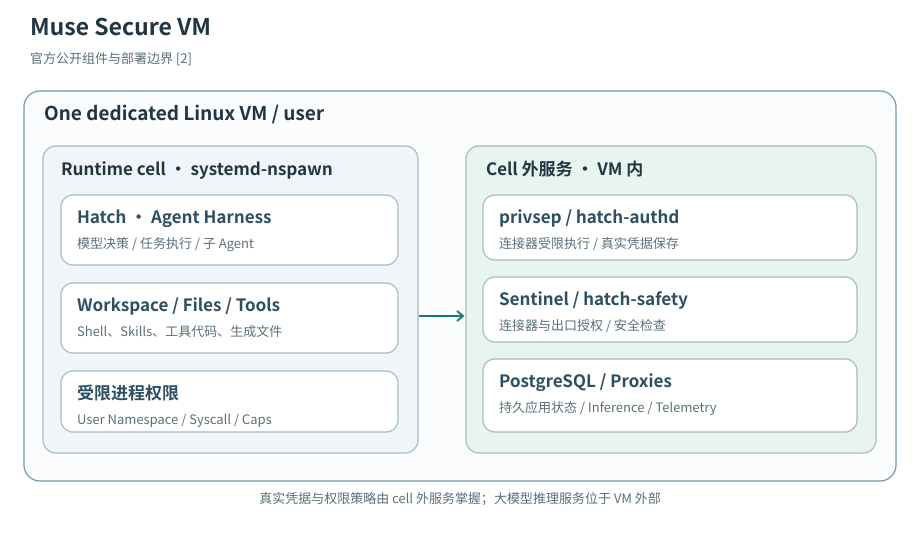
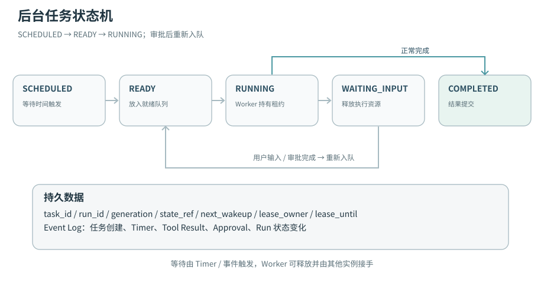
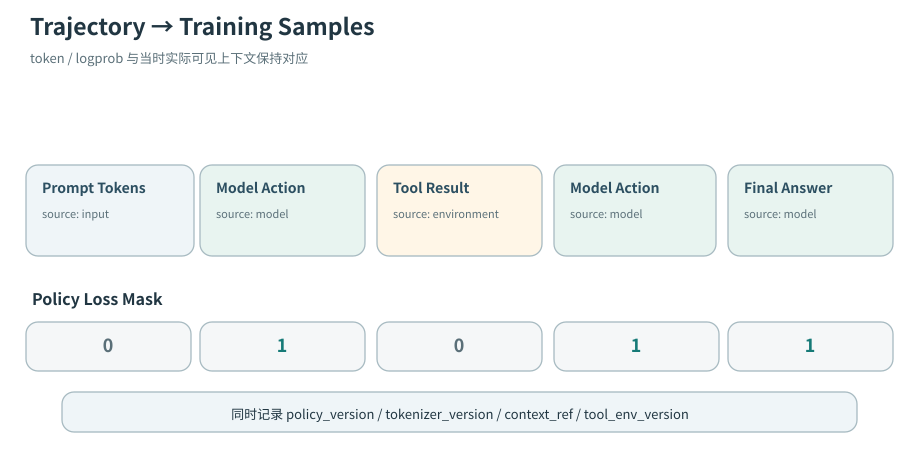

## 太长不看（TL;DR）

2026 年 9 月，Meta 发布 Muse，OpenAI 推出 Dots（基于 GPT-6 Astra）。这两款产品将 C 端 Agent 从单次会话窗口扩展为具备独立云端环境、可跨天运行的后台系统。

要让这类后台 Agent 稳定运行，系统层面主要解决三个问题：**怎么隔离工具权限、进程挂了怎么防重复执行、等待期间怎么省显存**。核心结论如下：

1. **权限控制必须落到操作系统进程上，不能靠 Prompt 约束**。模型在执行任务时会读取不可信网页和外部文件，运行工具的进程不能直接拿到 OAuth 密钥，也不能拥有修改安全规则的权限。Muse 用 `systemd-nspawn` 和 User Namespace 把模型执行环境关在 `runtime cell` 容器里，密钥代填和动作审批都放在容器外的独立服务中，通过内核 `SO_PEERCRED` 校验调用进程身份。
2. **工作目录长期保留，但执行进程用完即放**。一个任务跑几天，不代表 Worker 进程和 GPU 显存要占几天。工作目录、数据库记录和审批状态落盘保存；沙箱进程、浏览器和推理请求只在真正干活时按需分配。
3. **进程崩溃恢复最难处理的是"外部接口已执行成功、本地还没来得及落库"的窗口**。本地数据库事务管不到第三方发邮件或扣款接口。如果下游接口既不支持幂等键、也没法按单号查结果，直接重试就会导致重复发信或重复扣款。此时任务必须停在 `UNKNOWN` 状态，等人工确认后再继续。
4. **长周期任务改变了 KV Cache 管理与 RL 训练数据构造方式**：工具执行与人工审批等待会拉长请求跨度，推理侧需结合等待时长将 KV Cache 分层下沉（如 SGLang HiCache）或按需重算；训练侧则需用 `response_mask` 屏蔽工具返回与系统注入的 Token，并避免在隐私脱敏改写上下文后直接复用原有的采样 `logprob`。

| 对比项 | 会话型助手（临时沙箱） | Muse（Meta，2026.09） | OpenAI Dots（GPT-6 Astra，2026.09） | 关键设计点 |
|---|---|---|---|---|
| **运行环境** | 按会话分配临时容器，结束后销毁 | 每用户独立 Linux VM，状态存本地 PostgreSQL 与磁盘 | 每个 dot 配独立云电脑，支持桌面端授权连接用户本地电脑 | 存储磁盘长期保留，执行进程可随时销毁重建 |
| **权限隔离** | 容器级隔离，通常不保存长期凭据 | 同一 VM 内拆分容器内外：`Hatch` 在 `runtime cell` 内，安全服务在 cell 外 | 云电脑、本地电脑、云浏览器、密码管理器分别独立授权 | 工具执行进程与真实密钥隔离，禁止模型进程直接读密钥 |
| **操作审批** | 依赖模型对齐或前端简单确认 | Sentinel 独立审批 + `hatch-authd` 替身令牌 + eBPF 数据流追踪 | 插件权限 + Custom Rules + 关键动作 Auto-review + 主动研究强制只读 | 审批记录绑定具体参数与附件哈希，防止审批后文件被改写 |
| **中断恢复** | 连接断开即终止，需重新发起 | 任务状态与文件系统落盘，支持后台 cron 与多子 Agent 续跑 | 区分 `Scheduled / In progress / Completed`，支持跨端指令与人工接管（Take over） | 用租约 + `generation` 拦截超时旧 Worker；按外部接口是否幂等决定能否重试 |
| **推理缓存与 RL** | 单轮或短多轮，前缀基本固定 | 跨天等待 + 动态记忆更新，清理 PII 后用于训练 | 长周期任务 + 跨应用 Memory 积累，主动研究笔记默认不用于训练 | 推理侧按等待时长下沉 KV；训练侧对齐采样 Token 与 `response_mask` |

> **资料说明**：文中关于 Muse 和 Dots 的架构组件与功能边界来自官方技术博客和帮助文档 [1–6]；数据库表结构、租约 SQL、`recovery_lab.py` 故障注入实验、KV 容量计算及 RL 样本分析，则是结合 Linux、分布式系统与开源框架（SGLang / vLLM / veRL）做的技术推导与实验，不代表两款闭源产品的内部代码实现。

---

## 1. 从单次会话到后台长任务：多了哪几个问题？

典型的 C 端对话助手即使接入了搜索和代码沙箱，生命周期也绑定在单次请求内：请求进入网关 → 组装 Context → 模型调用工具 → 流式输出 → 写回存储。用户关闭页面后，执行环境即可回收。

当任务变为"每天定时检查项目邮件、生成汇总文档、等待用户确认后发送"时，系统需要解决三个新问题：

1. **连接断开后，任务由谁持有？** 客户端连接不能再作为任务的唯一容器，任务必须作为独立的状态机保存在服务端调度器中。
2. **等待期间，计算资源如何释放？** 外部 API 调用耗时数秒，人工审批可能耗时数小时。若在等待期间一直占用 Worker 进程和 GPU KV Cache，并发槽位很快会被耗尽。
3. **跨任务共享什么、隔离什么？** 工作文档和用户长期偏好（Memory）需要跨任务保留；但单次任务的临时授权、凭据和从外部网页下载的脚本，不能默认扩散到后续任务。

<picture class="architecture-figure"><source media="(max-width: 680px)" srcset="/assets/img/posts/personal-agent-runtime/fig-01-runtime-patterns.mobile.svg"></picture>

目前业界的架构设计可分为三类：Anthropic 在 claude.ai 中使用按会话分配的临时容器，在 Managed Agents 中则将 `session`（外置事件记录）、`harness`（执行循环）和 `sandbox`（沙箱环境）拆分为独立接口——按需创建执行环境后，中位 TTFT 降低约 60%，P95 降低 90% 以上 [7]。Muse 和 Dots 则采用了用户级（或 dot 级）持久云电脑方案。

---

## 2. Muse 与 OpenAI Dots 的云电脑架构

### 2.1 Muse：单用户 VM 内的容器与权限拆分

Meta 为每位 Muse 用户分配一台独立的 Linux VM，内置 Chromium 浏览器、编译工具链、文件系统和 PostgreSQL，支持运行 cron 定时任务、派生子 Agent 以及编写自定义 CLI 工具 [1, 2]。模型推理与遥测通过受控代理（Proxy）访问远端 GPU 集群。

该架构的核心设计是在**单台用户 VM 内部划分出两个安全域**。

<picture class="architecture-figure"><source media="(max-width: 680px)" srcset="/assets/img/posts/personal-agent-runtime/fig-02-muse-vm.mobile.svg"></picture>

Muse 的执行框架为 `Hatch`。若让 `Hatch` 直接以 VM 的 root 权限运行，一旦模型在读取外部网页或邮件时遭遇提示词注入（Prompt Injection），执行进程就可能篡改防火墙规则或直接读取磁盘上的 OAuth 密钥。为此，Muse 使用 `systemd-nspawn` 将 `Hatch` 和工作空间限制在 **runtime cell** 容器内，而将凭据管理、权限审批和安全检查服务部署在 **cell 外的 VM 宿主侧**：

| 组件 | 部署位置 | 核心职责 |
|---|---|---|
| `Hatch` 与工作空间 | Runtime cell 内 | 运行 Agent Loop、读写工作空间文件、执行脚本与 CLI |
| `privsep` workers | Cell 外（VM 宿主侧） | 以受限权限执行内置连接器（如邮件、日历接口） |
| `hatch-authd` | Cell 外 | 保管真实 OAuth 凭据，仅向 cell 内发放替身令牌（Stub Token） |
| `Sentinel` | Cell 外 | 审批连接器动作与网络出口请求，接收独立界面的用户确认信号 |
| `hatch-safety` | Cell 外 | 对模型输入与输出执行独立安全检查 |
| PostgreSQL / Proxy | Cell 外 | 持久化应用状态；提供受约束的远端模型推理与遥测通道 |

`Hatch` 在 cell 内安装依赖或管理文件时仍需要容器内的 `root` 视图，但不能因此获得 VM 宿主侧的特权。这通过 Linux **User Namespace（用户命名空间）** 的 UID 映射实现 [8, 9]：进程在 cell 内看到的 `uid=0(root)`，通过 `/proc/<pid>/uid_map` 映射到 VM 外层只是一个普通非特权 UID；同时剥离 `CAP_SYS_PTRACE`、`CAP_NET_ADMIN` 等 Capabilities，并禁用 `io_uring` 等高风险系统调用。即使 cell 内进程被诱导执行恶意命令，也无法修改 cell 外的 `Sentinel` 策略或读取 `hatch-authd` 内存。

```bash
# 查看当前进程的 UID 映射与命名空间标识
cat /proc/self/uid_map
cat /proc/self/gid_map
readlink /proc/self/ns/user
```

这里存在三层不同的隔离边界：**租户间 VM 隔离**限制跨用户数据访问；**VM 内 cell 与宿主服务隔离**限制 Agent 篡改自身权限边界；**云服务商能否读取 VM 内存**则取决于硬件级 Confidential VM（机密虚拟机）。Meta 在 2026 年 9 月的架构说明中也将 Confidential VM 列为后续演进方向，与当前的 Secure VM 做了明确区分 [2]。

### 2.2 OpenAI Dots：云电脑与本地电脑协同

OpenAI 发布的 Dots（搭载 GPT-6 Astra）为每个 dot 提供独立的持续工作身份和专属 **Cloud Computer（云电脑）**，同时支持用户在桌面端显式授权后，让云端任务连接并操作用户的**本地电脑** [3, 4]。

<picture class="architecture-figure"><source media="(max-width: 680px)" srcset="/assets/img/posts/personal-agent-runtime/fig-03-dots-computer.mobile.svg"></picture>

Dots 在工程设计上有三个重点机制：

1. **云端与本地电脑分开授权**：云电脑负责运行后台任务、云浏览器和插件；需要访问本地代码库或调用本机 Skills 时，dot 可在桌面端授权后向本地电脑派发任务。云电脑、本地电脑、云浏览器、网络访问和密码管理器分别受独立权限控制，云端网站的登录状态与用户本机浏览器隔离 [4, 5]。
2. **可随时接管（Take over）的任务视图**：用户从 ChatGPT 或 Slack 向同一个 dot 交付的目标，统一汇聚到 `In progress`、`Scheduled`、`Completed` 视图。当云浏览器遇到登录验证或敏感操作时，用户可以实时查看并接管画面，完成后再将控制权交还给 dot。
3. **主动研究（Proactive Research）强制只读**：dot 在后台执行定时检查或主动研究时，**仅可使用只读连接器信息**，不能发送消息、修改插件数据或操控浏览器与电脑；只有用户明确下达的任务，才能在通过 Custom Rules 与 Auto-review 检查后执行外部写操作 [3, 6]。这一限制避免了后台定时任务在无人值守时误发消息或修改外部数据。

---

## 3. 后台任务调度与子 Agent 限流

### 3.1 用数据库租约管理后台任务

为了支持跨天等待而不常驻占用计算进程，调度系统需要将 `Task`（长期计划）与 `Run`（单次执行实例）分离，通过数据库租约（Lease）管理执行权 [10]：

<picture class="architecture-figure"><source media="(max-width: 680px)" srcset="/assets/img/posts/personal-agent-runtime/fig-04-task-state.mobile.svg"></picture>

```python
from dataclasses import dataclass
from typing import Literal

@dataclass
class AgentRun:
    run_id: str
    task_id: str                 # 同一长期 Task 可触发多次 Run
    owner_id: str
    status: Literal["READY", "RUNNING", "WAITING_INPUT", "COMPLETED", "FAILED"]
    generation: int              # 每次领取租约递增，用于拦截过期 Worker 写回
    state_ref: str               # 外置检查点 / 产物清单引用
    lease_owner: str | None
    lease_until_ms: int | None
    next_wakeup_ms: int | None
```

当任务执行到需要用户审批的步骤时，Worker 将状态更新为 `WAITING_INPUT` 并立即释放自身进程资源；审批事件到达后，调度器将状态转回 `READY` 并重新入队。

在分布式调度中，必须防范**旧 Worker 超时后的晚到写回**：旧 Worker 因网络阻塞导致租约过期，新 Worker 接管任务并将 `generation` 加 1；随后旧 Worker 恢复连接并尝试提交结果。仅在 Worker 进程内存中设置 `cancelled=True` 无法拦截已在途的写入请求，必须在存储层通过 `generation` 条件更新实现 Fencing（栅栏保护）：

```sql
UPDATE agent_runs
SET lease_owner = :worker_id,
    lease_until = now() + interval '60 seconds',
    generation = generation + 1,
    status = 'RUNNING'
WHERE run_id = :run_id
  AND status IN ('READY', 'RUNNING')
  AND (lease_until IS NULL OR lease_until < now())
RETURNING generation, state_ref;
```

后续所有状态与产物提交均需携带 `WHERE run_id = :run_id AND generation = :my_gen`，代次不匹配时直接拒绝写入。

### 3.2 子 Agent 的并发限流

Muse 支持并发运行多个子 Agent，Dots 支持将任务委派给 Codex 或本地电脑。若仅对单个 Agent 进程限制 `max_concurrent_tools = 4`，当父任务派生 4 个子 Worker、每个子 Worker 各自发起 4 路请求时，底层接口和浏览器实例就会承受 **16 路并发扇出**。

多 Agent 调度的资源控制需要满足两条约束：
1. **配额沿任务树全局累计**：Token 预算、浏览器并发实例数和外部 API QPS 必须绑定在根 `task_id` 上统一扣减。
2. **仅回传产物引用与摘要，保留来源可信度标记**：子 Agent 完成检索或脚本执行后，向父 Agent 返回带版本号的 `artifact_ref` 和精简摘要，避免将原始长网页和 Shell 日志拼入主 Context。同时，由外部网页汇总生成的摘要仍需保留不可信来源属性，不能在跨 Agent 传递后自动提升为系统指令权限。

---

## 4. 文件与记忆存储

### 4.1 先写文件，再提交数据库记录

当任务生成报告文件写入工作卷，并在 PostgreSQL 中记录完成状态时，文件系统与数据库之间通常没有分布式事务。若先写数据库完成标记、后写磁盘文件，一旦写文件失败，下游任务读取引用时就会遇到文件缺失。

安全的发布顺序是：**先写入不可变文件并计算内容哈希（SHA256），再在数据库单事务内同时写入 `artifacts` 记录与 `task_events` 完成事件**：

```sql
CREATE TABLE artifacts (
    artifact_id TEXT NOT NULL,
    revision BIGINT NOT NULL,
    content_digest TEXT NOT NULL,      -- 文件内容的 SHA256
    object_uri TEXT NOT NULL,          -- 如 workspace://reports/october.pdf
    visibility_epoch BIGINT NOT NULL,  -- 权限/删除可见性代次
    PRIMARY KEY (artifact_id, revision)
);

CREATE TABLE derived_views (
    view_id TEXT PRIMARY KEY,
    source_manifest TEXT NOT NULL,     -- 依赖的原始事件与文件版本范围
    producer_version TEXT NOT NULL,    -- 摘要模型或处理逻辑版本
    input_visibility_epoch BIGINT NOT NULL,
    output_artifact_ref TEXT NOT NULL
);
```

若文件写入成功但数据库事务失败，仅产生可由后台垃圾回收清理的孤立文件，不会破坏读路径的一致性。

<picture class="architecture-figure"><source media="(max-width: 680px)" srcset="/assets/img/posts/personal-agent-runtime/fig-05-state-memory.mobile.svg"></picture>

### 4.2 删除记忆后如何清理派生缓存

Muse 允许用户查看、编辑和删除工作空间中的 Memory 文件；Dots 也支持管理记忆与断开插件 [2, 4]。当用户删除一封敏感邮件或某条记忆时，该数据可能已经派生出全文索引、向量条目、会话摘要、已组装的 Prompt 以及对应的 KV Cache。仅删除向量索引中的单条记录，旧摘要和缓存仍可能在后续生成中泄露已删除内容。

工程上可以通过递增 **`visibility_epoch`（可见性版本号）** 来屏蔽旧数据：
- 用户执行删除或撤销权限时，先同步递增权威存储中的 `visibility_epoch`；读取派生摘要或恢复 KV Cache 时校验 `input_visibility_epoch`，使旧代次的派生对象立即在逻辑上不可见；
- 后台异步清理向量索引、文件副本和远端缓存块；
- **备份恢复后的权限对账**：使用 PostgreSQL PITR（时间点恢复）从基础备份和 WAL 恢复数据库时 [11]，不能将备份时间点之后发生的权限撤销和删除操作一并回滚。数据库恢复完成后，必须先与独立的权限及删除记录对账，再重新开放读取。

在检索后端选型上，个人 Memory 通常带有严格的 `owner_id` 和时间过滤条件。过滤后候选集仅剩数十至数百条时，关系库索引或 CPU 向量距离计算即可满足延迟要求；只有跨租户共享文档库或亿级规模向量召回，才需要引入 GPU ANN 引擎。

---

## 5. 凭据隔离与网络出口控制

### 5.1 用 Unix Domain Socket 隔离 OAuth 密钥

若让 cell 内的工具脚本直接持有 OAuth 密钥，一旦模型遭受提示词注入并执行任意命令，密钥就会直接泄露。

Muse 将连接器拆分为两部分：cell 内的 CLI 仅负责解析参数、打开调用方有权读取的本地文件，然后通过 **Unix Domain Socket** 请求 cell 外的 `privsep` worker [2]。服务端通过内核的 `SO_PEERCRED` 获取对端进程的真实 `PID / UID / GID`，并通过 `SCM_RIGHTS` 接收已打开的文件描述符（FD）[12]：

```python
import socket, struct

# 服务端直接从内核读取对端进程凭据，不依赖请求体自报的身份字段
n = struct.calcsize("3i")
raw = conn.getsockopt(socket.SOL_SOCKET, socket.SO_PEERCRED, n)
pid, uid, gid = struct.unpack("3i", raw)
```

真实 OAuth 凭据保存在 cell 外的 `hatch-authd` 中，cell 内代码仅接触受限的替身令牌（Stub Token）；请求经 `Sentinel` 审批通过后，由受控出口代理在流量发出前替换为真实凭据。

<picture class="architecture-figure"><source media="(max-width: 680px)" srcset="/assets/img/posts/personal-agent-runtime/fig-06-authorization.mobile.svg"></picture>

### 5.2 审批记录绑定文件哈希（防 TOCTOU）

仅传递文件描述符仍不足以保证附件内容不被篡改。FD 锁定的是已打开的文件对象（inode），若 cell 内另一个进程在用户批准发送 `report.pdf` 之后、实际上传之前修改了该文件内容，最终发送出去的就会是篡改后的版本——即 **TOCTOU（Time-of-Check to Time-of-Use）竞态**。

防御 TOCTOU 竞态要求**审批记录必须绑定不可变的内容摘要，而非文件路径**：
1. 发起审批前，先将待发送文件固化为不可变产物（或使用 Linux `memfd_create` 配合 `F_ADD_SEALS` 施加写封印 [13]），计算 `content_digest`；
2. 用户在 `Sentinel` 或 Dots 审批界面确认后，生成的 `Grant` 对象直接绑定目标账户、收件人、动作类型与 `action_digest`：

```python
@dataclass(frozen=True)
class Grant:
    principal_id: str
    task_id: str
    action_digest: str        # 规范化后的"目标 + 参数 + 附件版本 SHA256"
    permission_epoch: int     # 权限撤销或策略变更时递增
    expires_at: int

def validate_before_dispatch(action, grant, authority, now):
    if (action.principal_id, action.task_id) != (grant.principal_id, grant.task_id):
        raise Denied("principal or task mismatch")
    if action.canonical_digest != grant.action_digest:
        raise Denied("approved payload changed after review")
    if grant.permission_epoch != authority.current_epoch or now >= grant.expires_at:
        raise Denied("grant revoked or expired")
```

### 5.3 网络出口控制：Tainted Egress 与受控浏览器

单纯依赖域名白名单无法拦截同一域名下的越权写操作。Anthropic 在 2026 年 5 月的公开复盘中记录过一起案例：白名单内的合法域名因同时提供上传 API，曾被用于将容器内文件提交到外部账户 [14]。域名白名单授予的是该域名下所有接口的可达性，出口控制必须进一步检查具体请求方法、目标账户与数据来源：

- **Tainted Egress**：Muse 使用 Linux eBPF 与 LSM（Linux Security Modules）钩子追踪进程是否读过用户私有数据 [2, 15]。一旦进程读取了私有文件，内核钩子就给它打上 `Tainted` 标记（并沿子进程派生、管道和共享内存传递）。带标记的进程向外发请求时，自动放行规则失效，强制转交 `Sentinel` 审批。
- **CDP 代理隔离浏览器**：Muse 将 Chrome DevTools Protocol（CDP）置于 cell 外管理，浏览器子 Agent 只能读取无障碍树（Accessibility Tree）快照并调用受限操作接口，**不能执行任意页面 JavaScript**。Dots 则在登录和敏感操作时切换为用户接管模式，密码管理器凭据由宿主侧安全填充，不暴露给模型上下文 [2, 4]。

---

## 6. 调用外部接口时的崩溃恢复

### 6.1 远端已提交、本地未落盘的故障窗口

在 LangGraph 的 `interrupt()` 或 Temporal 的 Workflow Replay 机制中，恢复任务时会从检查点重新执行节点代码 [10, 16]。如果节点里调用了发邮件、建日程或扣款等第三方写接口，最容易出问题的窗口是**外部服务已经执行成功，但 Worker 在把 `COMPLETED` 写回本地数据库之前崩溃了**：

<picture class="architecture-figure"><source media="(max-width: 680px)" srcset="/assets/img/posts/personal-agent-runtime/fig-07-action-recovery.mobile.svg"></picture>

```text
控制端 Worker                 外部服务（邮件 / 支付 / 日历）
     |                                    |
     |-- 1. 落盘 SUBMITTED (action_id=A)  |
     |-- 2. 发起请求 (key=A) ------------>|
     |                                    |-- 3. 远端执行并提交生效
     X  4. 收到响应前进程崩溃               |
     |                                    |
  [新 Worker 接管恢复：本地状态为 SUBMITTED，需判断远端是否已执行]
```

此时本地数据库的 `generation` 栅栏只能防止旧 Worker 覆盖本地状态，无法阻止新 Worker 向不感知 `generation` 的第三方服务重复发请求。恢复策略取决于外部服务支持的接口能力：

1. **支持服务端幂等键（Idempotency Key，如 Stripe API [17]）**：重试时必须复用首次落盘时生成的稳定 `action_id`。服务端识别相同幂等键后直接返回首次执行结果，避免重复生效。
2. **支持按业务标识可靠查询**：恢复时先调用查询接口对账（Reconcile），确认远端已完成且参数摘要匹配后，直接在本地补记 `COMPLETED`，不再重发请求。
3. **既无幂等键、也无可靠查询接口（如普通邮件发送或网页表单提交）**：**不能自动重发**。状态机必须停留在 `UNKNOWN` 状态，交由人工确认或外部证据介入。

### 6.2 `recovery_lab.py`：8 个故障注入场景验证

为验证上述恢复逻辑，使用 Python 标准库编写了故障注入实验 `recovery_lab.py`：用两个独立的 SQLite 数据库分别模拟 Agent 控制存储和外部服务，在远端提交前后调用 `os._exit()` 终止子进程，再启动新进程执行恢复：

```python
# 恢复阶段对 SUBMITTED 状态动作的处理逻辑
if state == "SUBMITTED":
    if service.supports_idempotency:
        result = service.execute(payload, key=stable_action_id)
    elif service.supports_reliable_lookup:
        result = service.lookup(stable_action_id)
        if not result or not result.matches(payload):
            return mark_unknown()
    else:
        return mark_unknown()
mark_completed(result)
```

结合派发前的四项检查（`revoked` 撤销检查、`task_generation` 代次检查、`permission_epoch` 权限代次检查、`approved_digest` 参数摘要检查），8 个场景的验证结果如下：

| 注入场景 | 恢复后本地状态 | 外部实际生效次数 | 结果说明 |
|---|---|:---:|---|
| 1. 朴素重试：远端提交后进程 `os._exit()` | `COMPLETED` | **2（重复执行）** | 本地状态看似正常，外部服务实际重复执行了两次 |
| 2. 服务端幂等：远端提交后崩溃，带固定 `action_id` 重试 | `COMPLETED` | **1** | 服务端命中幂等键去重，直接返回首次执行结果 |
| 3. 查询对账：远端提交后崩溃，恢复时先查业务单号 | `COMPLETED` | **1** | 查到远端已完成记录，本地补记完成，不重发请求 |
| 4. 无幂等无查询：远端提交后崩溃 | `UNKNOWN` | **1** | 停止自动重试，避免重复发信或重复扣款 |
| 5. 无幂等无查询：派发网络请求前崩溃 | `UNKNOWN` | **0** | 同样停在 `UNKNOWN` 等待确认，以牺牲自动完成率换取不重发保证 |
| 6. 等待期间用户撤销授权（`permission_epoch` 递增） | `DENIED` | **0** | 派发前拦截，旧检查点中的批准记录失效 |
| 7. 审批通过后附件或收件人被修改（TOCTOU） | `DENIED` | **0** | `canonical_digest != approved_digest`，拒绝派发 |
| 8. 租约过期后旧 Worker 尝试派发 | `DENIED` | **0** | `task_generation` 落后于当前权威代次，栅栏拦截生效 |

对比场景 1 和场景 4、5 可以看出：**如果下游接口既不支持幂等、也没法查询执行结果，系统就不可能同时做到"崩溃后 100% 自动恢复"和"绝不重复执行外部操作"**。遇到无法确认结果的请求时，停在 `UNKNOWN` 等待人工介入是最稳妥的处理方式。

---

## 7. 长周期任务下的 KV Cache 与 RL 训练

当 Agent 任务从数秒的单次问答延长为包含工具等待与人工审批的多日流程时，推理缓存与强化学习数据管道也需要相应调整。

### 7.1 按等待时长分级管理 KV Cache

以 32 层、8 KV Head、Head Dim 128、BF16 精度的模型为例，单 Token 的逻辑 KV Cache 占用为：

<div class="formula">2 (K + V) × 32 layers × 8 KV heads × 128 dim × 2 bytes = <strong>128 KiB / token</strong></div>

单个 16K 上下文的任务占 **2 GiB** 显存。若大量任务在等待外部响应或用户审批期间持续驻留 GPU HBM，在线推理的并发容量将显著下降。

<picture class="architecture-figure"><source media="(max-width: 680px)" srcset="/assets/img/posts/personal-agent-runtime/fig-08-kv-lifecycle.mobile.svg"></picture>

面向持续任务的推理系统需要按等待时长管理 KV 生命周期：
- **按等待窗口分级存储**：数秒内的短工具调用保留在本地 HBM 或下沉至 Host Pinned Memory（L2）；分钟至小时级的审批等待，通过 [SGLang HiCache](/posts/sglang-hicache/) 异步写入 L3（NVMe 或 Mooncake RDMA 内存池）并释放 GPU 显存；若恢复时发现前缀已因动态 Memory 更新而大幅改变，直接重算 Prefill 往往比跨节点搬运更快。
- **跨任务复用时的权限与格式检查**：vLLM 等引擎通过块级 Hash 链实现 Prefix Caching，并用 `cache_salt` 隔离不同租户的缓存 [18]。在持久 Agent 场景下，复用缓存除了要求 Token 前缀和模型权重一致，还要检查量化格式/TP 切分是否匹配，以及当前请求的 `visibility_epoch` 是否仍有权读取该前缀包含的数据。

### 7.2 为什么线上活动日志不能直接拿来训 RL？

Muse 和 Dots 均说明在满足用户隐私设置并清理 PII（个人身份信息）后，交互轨迹可用于模型训练 [2, 6]。但在工程实现上，**面向用户展示的活动日志（Activity Log）不能直接作为强化学习的训练样本**。

<picture class="architecture-figure"><source media="(max-width: 680px)" srcset="/assets/img/posts/personal-agent-runtime/fig-09-trajectory.mobile.svg"></picture>

结合 [Search-R1 训练笔记](/posts/search-r1-notes/) 与 veRL 的 Agent Loop 设计 [19]，持久 Agent 的训练数据管道需要处理三个问题：

1. **用 `response_mask` 屏蔽非模型采样 Token 的梯度**：一条完整轨迹中包含模型采样的动作（`model_sample`）、工具返回结果以及用户审批信号。计算 Policy Loss 时，必须通过 `response_mask`（对应 Search-R1 中的 `info_mask`）将工具返回和系统注入的 Token 置 0——这些外部输入仅作为后续推理的 Attention 上下文，不作为策略动作参与梯度更新。
2. **隐私脱敏后不能直接复用旧 `logprob`**：轨迹进入训练集前，脱敏流程会将上下文中的真实邮箱、手机号替换为占位符。一旦前文条件上下文 $s$ 发生改变，采样阶段记录的旧策略对数概率 $\log \pi_{\theta_{\text{old}}}(a \mid s)$ 与脱敏后的新序列在概率条件上不再对应。若直接用脱敏后的文本搭配脱敏前的旧 `logprob` 计算 PPO 重要性采样比率，会导致梯度估计失真。工程上要么在受控环境内基于原始 Token 序列完成校验，要么对脱敏后的新序列重新前向计算参考分布，或在可复现的模拟环境（如 $\tau$-bench 类状态基准 [20]）中重新采样。
3. **多子 Agent 轨迹的偏序关系**：多个子 Worker 并行执行时，按时间戳将所有日志直接拼接成单条线性序列，会引入"Worker B 观察到了 Worker A 中间结果"的伪因果关系。训练样本需通过 `context_manifest` 记录每次模型调用实际可见的输入范围，在每个策略执行主体内部独立组织采样序列。

---

## 参考资料

1. [Meta — How We Designed Muse](https://introducing.muse.ai/)（2026-09）
2. [Meta — How We Built Safety Into Muse](https://research.meta.ai/blog/security-and-safety-for-ai-agents-our-approach-with-muse)（2026-09-08）
3. [OpenAI — Introducing dots](https://openai.com/index/introducing-dots/)（2026-09-29）
4. [OpenAI Help — Getting started with your dot](https://help.openai.com/en/articles/20001530-getting-started-with-your-dot)
5. [OpenAI Help — Manage dots in ChatGPT workspaces](https://help.openai.com/en/articles/20001554-manage-dots-in-chatgpt-workspaces)
6. [OpenAI Help — Dots privacy, security, and safety FAQs](https://help.openai.com/en/articles/20001529-dots-privacy-security-and-safety-faqs)
7. [Anthropic — Managed Agents](https://www.anthropic.com/engineering/managed-agents)
8. [systemd-nspawn(1) — Linux manual page](https://man7.org/linux/man-pages/man1/systemd-nspawn.1.html)
9. [user_namespaces(7) — Linux manual page](https://man7.org/linux/man-pages/man7/user_namespaces.7.html)
10. [Temporal — Tasks and Workflow Replay](https://docs.temporal.io/tasks)
11. [PostgreSQL — Continuous Archiving and Point-in-Time Recovery (PITR)](https://www.postgresql.org/docs/current/continuous-archiving.html)
12. [unix(7) — SO_PEERCRED and SCM_RIGHTS](https://man7.org/linux/man-pages/man7/unix.7.html)
13. [memfd_create(2) — File Sealing](https://man7.org/linux/man-pages/man2/memfd_create.2.html)
14. [Anthropic — How we contain Claude across products](https://www.anthropic.com/engineering/how-we-contain-claude)（2026-05-25）
15. [Linux Kernel — LSM BPF Programs](https://docs.kernel.org/bpf/prog_lsm.html)
16. [LangGraph — Interrupts and Checkpointing](https://docs.langchain.com/oss/python/langgraph/interrupts)
17. [Stripe API — Idempotent Requests](https://docs.stripe.com/api/idempotent_requests)
18. [vLLM — Automatic Prefix Caching](https://docs.vllm.ai/en/latest/design/prefix_caching/)
19. [veRL — Agent Loop Documentation](https://verl.readthedocs.io/en/latest/advance/agent_loop.html)
20. [τ-bench: A Benchmark for Tool-Agent-User Interaction in Real-World Domains](https://arxiv.org/abs/2406.12045)
