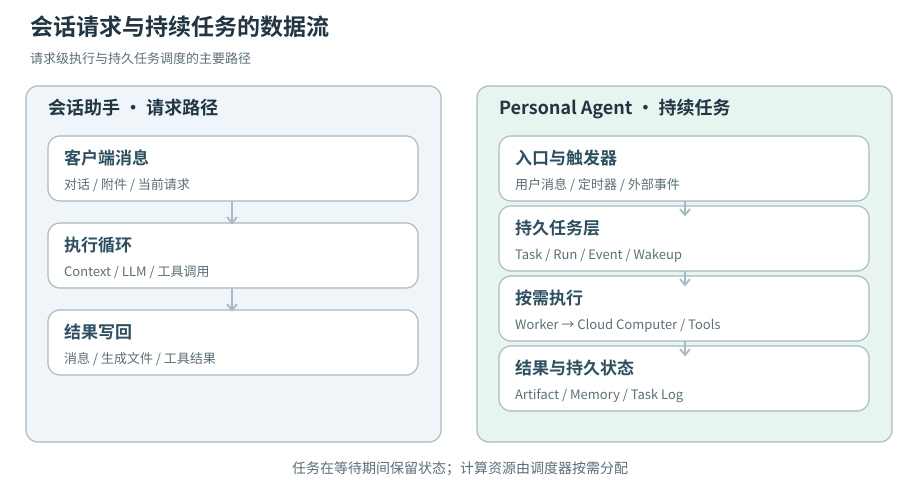
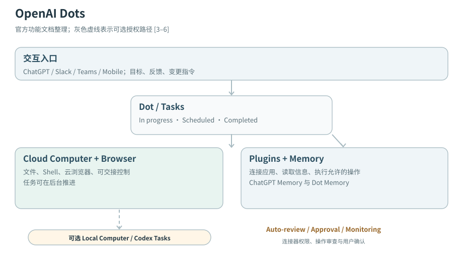
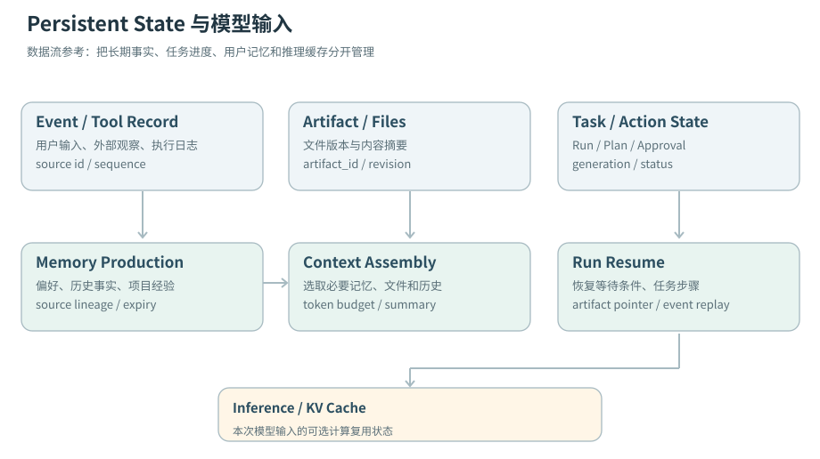
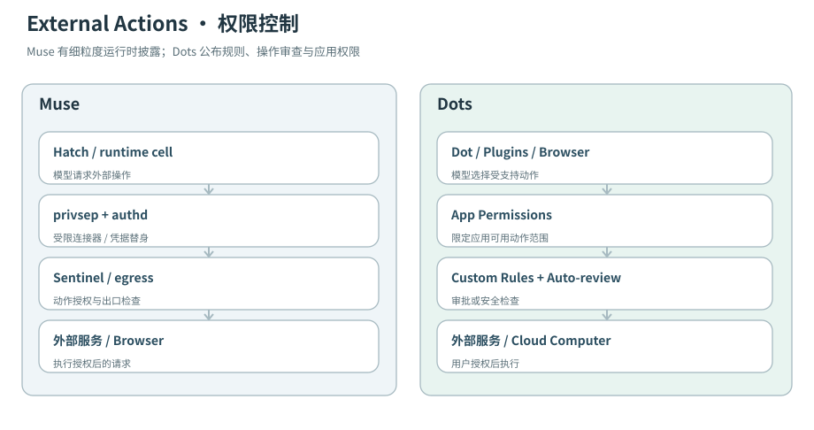
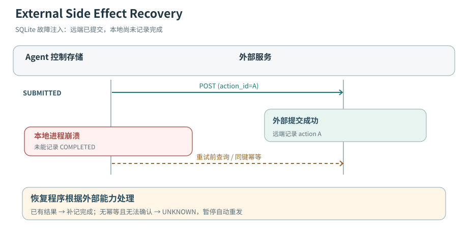
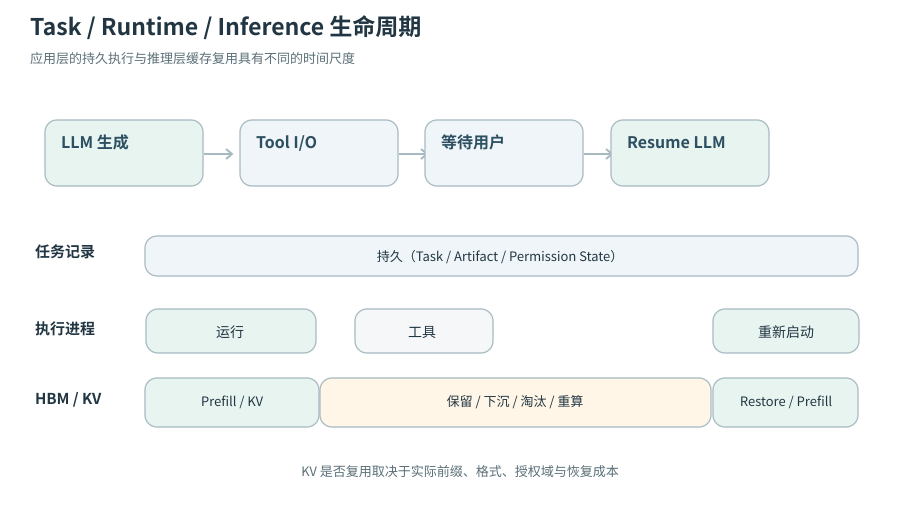

## 太长不看（TL;DR）

2026 年秋，Meta 发布 Muse，OpenAI 推出 Dots（基于 GPT-6 Astra）。这两款产品把 C 端助手从「关掉网页就结束的聊天窗口」推向了「后台跑几天、能操作真实账户的云电脑 Agent」。

剥掉产品包装，设计一个能长期存活的 Personal Agent Runtime，本质上是在回答三个系统工程问题：**权限放在哪、进程挂了怎么续、GPU 怎么别被等待时间拖死**。核心判断如下：

1. **Prompt 拦不住越权，安全边界必须下沉到 OS 进程与内核凭据**。模型会接触恶意网页和第三方文件，不能让执行工具的进程直接持有 OAuth 密钥，更不能靠系统提示词做权限控制。Muse 用 `systemd-nspawn` + User Namespace 把模型执行环境关进 `runtime cell`，凭据代填和动作审批全部交给 cell 外的独立服务，靠内核 `SO_PEERCRED` 验明调用方正身。
2. **「长寿的工作空间」必须搭配「随时可杀的执行进程」**。一个任务跑三天，绝不意味着一个 Python 进程和一块 GPU 要陪跑三天。工作目录、数据库事件和授权记录需要持久化；但沙箱进程、浏览器会话和推理请求必须按需拉起、用完即放。
3. **Agent 故障恢复最难的不是重跑节点，而是「远端已生效、本地未落盘」的提交窗口**。数据库事务包不住第三方发信或扣款 API。没有服务端幂等键或可靠对账接口时，盲目重试只会把「一次崩溃」变成「重复发信」。状态机里必须显式保留 `UNKNOWN` 状态，宁可停下来等人确认，也不能静默重放外部副作用。
4. **长程 Agent 会打破推理与训练的旧假设**：等待工具和人工审批会让 KV Cache 在 HBM 里空转，逼着推理层引入分层下沉（HiCache）与按需重算；而多轮工具注入和隐私脱敏会破坏采样序列，直接拿业务活动日志去训 RL 必然导致 `logprob` 条件错配。

| 核心维度 | 会话型助手（Stateless Chat + 临时沙箱） | Muse（Meta，2026.09） | OpenAI Dots（GPT-6 Astra，2026.09） | 工程设计底线 |
|---|---|---|---|---|
| **计算与存储载体** | 按会话分配临时容器，用完销毁 | 每用户独占 Linux VM，状态存本地 PostgreSQL + 工作卷 | 每个 dot 配独立云电脑，支持桌面端授权挂载用户本地电脑 | 存储卷跟随用户长期保留，执行进程无状态化 |
| **执行隔离边界** | 容器级隔离，通常无跨会话凭据 | VM 内再切两个安全域：`Hatch` 关在 `runtime cell` 内，安全服务在 cell 外 | 云电脑、本地电脑、云浏览器、密码管理器分别独立授权 | 执行框架与真实凭据物理隔离，禁止模型进程直读密钥 |
| **操作审批与防线** | 依赖模型对齐或简单工具确认框 | Sentinel 独立审批 + `hatch-authd` 替身令牌 + eBPF 污染追踪 | 插件级权限 + Custom Rules + 关键动作 Auto-review + 主动研究强制只读 | 审批对象必须绑定「动作参数 + 附件内容哈希」，防 TOCTOU 篡改 |
| **中断恢复语义** | 刷新页面即中断，重来一遍 | 任务状态与文件系统落盘，支持后台 cron 与多子 Agent 续跑 | 区分 `Scheduled / In progress / Completed`，支持跨端指令与人工接管（Take over） | 租约 + `generation` 挡住僵尸 Worker 写回；外部写操作按幂等能力分级恢复 |
| **KV 与 RL 数据面** | 单轮或短多轮，前缀基本固定 | 跨天等待 + 动态记忆重写，需清理 PII 后回流训练 | 长周期任务 + 跨应用 Memory 积累，主动研究笔记默认不进训练 | 推理侧按等待时长做 KV 分层下沉；训练侧严守采样 Token 与 `response_mask` 保真 |

> **资料边界说明**：文中关于 Muse 和 Dots 的组件名称与能力边界均来自官方公开技术博客与文档 [1–6]；数据库表结构、`AgentRun` 租约 SQL、`recovery_lab.py` 故障注入实验、KV 容量推算及 RL 样本结构，则是我基于 Linux、分布式系统与推理框架（SGLang / vLLM / veRL）做的工程推演与实测，不代表两家闭源产品的内部源码。

---

## 1. 从「单次会话」到「持久任务」：架构矛盾变在哪？

传统的 C 端对话助手哪怕接了搜索和代码沙箱，生命周期也是绑死在一次 HTTP 流式请求里的：请求进网关 → 拼好 Context → 模型调工具 → 流式吐字 → 落库结束。只要用户关掉页面，执行环境就可以直接回收。

但当你让 Agent 去做「每天早上扫一遍项目邮件、改好周报草稿、等我点确认再群发」时，系统立刻撞上三个新矛盾：

1. **连接断了，谁来持有任务？** 网页 WebSocket 不能再当任务容器。任务必须脱离客户端连接，作为独立状态机活在服务端调度器里。
2. **等待期间，资源怎么拆？** 等外部 API 返回要几秒，等用户审批可能要几小时。如果让 Worker 进程和 GPU KV Cache 一直挂着等，单机并发很快就会被僵尸等待吃光。
3. **跨任务共享什么、隔离什么？** 上周生成的周报模板和用户偏好（Memory）需要跨任务复用；但某次操作拿到的临时上传令牌、或者刚从不可信网页抓下来的脚本，绝不能顺着工作目录污染下一个任务。

<picture class="architecture-figure"><source media="(max-width: 680px)" srcset="/assets/img/posts/personal-agent-runtime/fig-01-runtime-patterns.mobile.svg"></picture>

行业里目前演化出三种解法：Anthropic 在 claude.ai 里采用按会话分配的临时容器，而在 Managed Agents 中把 `session`（外置事件日志）、`harness`（执行循环）和 `sandbox`（沙箱环境）彻底拆成独立接口——按需拉起执行环境后，中位 TTFT 降了约 60%，P95 降了 90% 以上 [7]。Muse 和 Dots 则走得更远：直接给用户（或每个 dot）配一台长期存活的云端电脑。

---

## 2. 两种云端 Runtime 路线：Muse Secure VM vs OpenAI Dots

### 2.1 Muse：单用户专属 VM 内的「双安全域」切分

Meta 给 Muse 的定位很直接：每个用户一台专属 Linux VM，里面装好 Chromium、编译工具链、文件系统和 PostgreSQL，支持跑 cron 定时任务、派生子 Agent、甚至自己写 CLI 工具 [1, 2]。模型推理和遥测不跑在 VM 本地，而是通过受控代理（Proxy）发往远端 GPU 集群。

这套设计最值得细看的是它如何在**同一台用户 VM 内部切出两个安全域**。

<picture class="architecture-figure"><source media="(max-width: 680px)" srcset="/assets/img/posts/personal-agent-runtime/fig-02-muse-vm.mobile.svg"></picture>

Muse 的执行框架叫 `Hatch`。如果让 `Hatch` 直接以 VM 的 root 身份裸跑，一旦模型在浏览网页或读邮件附件时中了提示词注入（Prompt Injection），攻击者就能顺手改掉系统防火墙、偷走硬盘上的 OAuth Token。因此 Muse 用 `systemd-nspawn` 把 `Hatch` 和工作空间关进了一个叫 **runtime cell** 的容器里，而把所有跟权限、凭据、审计相关的服务全部留在 **cell 外的宿主侧（仍在该用户 VM 内）**：

| 组件 | 部署位置 | 核心职责 |
|---|---|---|
| `Hatch` 与工作空间 | Runtime cell 内 | 跑 Agent Loop、读写工作文件、执行自建脚本与 CLI |
| `privsep` workers | Cell 外（VM 宿主侧） | 以最小权限进程执行内置连接器（如邮件、日历 API） |
| `hatch-authd` | Cell 外 | 保管真实 OAuth 凭据，向 cell 内只发放替身令牌（Stub Token） |
| `Sentinel` | Cell 外 | 审批连接器动作与网络出口请求，接收用户专门界面的确认信号 |
| `hatch-safety` | Cell 外 | 对模型输入输出做独立安全审查 |
| PostgreSQL / Proxy | Cell 外 | 持久化应用状态；提供受限的远端模型推理与遥测通道 |

很多人会问：`Hatch` 在自己的 cell 里也需要装包、改配置，给了它 cell 内的 `root` 会不会穿透出来？

这里利用的是 Linux **User Namespace（用户命名空间）** 的 UID 映射机制 [8, 9]。进程在 cell 里执行 `id` 看到的是 `uid=0(root)`，但通过 `/proc/<pid>/uid_map` 映射到 VM 外层，其实只是一个毫无特权的普通用户 UID；再配合剥离 `CAP_SYS_PTRACE`、`CAP_NET_ADMIN` 等内核 Capabilities，禁用 `io_uring` 等高危系统调用，`Hatch` 就算被彻底攻破，也改不了 cell 外的 `Sentinel` 规则，更读不到 `hatch-authd` 的内存。

```bash
# 在容器内查看 UID 映射与所属命名空间
cat /proc/self/uid_map
cat /proc/self/gid_map
readlink /proc/self/ns/user
```

还要拎清三层完全不同的隔离边界：**租户间 VM 隔离**决定了用户 A 看不到用户 B 的文件；**VM 内 cell 与宿主服务隔离**决定了被注入的 Agent 不能篡改自己的权限策略；而**云厂商运维人员能否读取用户 VM 内存**，则需要硬件级 Confidential VM（机密虚拟机）提供密码学保证——Meta 在 2026 年 9 月的架构说明中也明确把 Confidential VM 列为下一步演进方向，没有拿普通 VM 隔离去混充机密计算 [2]。

### 2.2 OpenAI Dots：云电脑、跨端任务流与本地设备挂载

OpenAI 在同月发布的 Dots（搭载 GPT-6 Astra）展示了另一种产品组织方式：每个 dot 拥有独立的持续工作身份和一台专属 **Cloud Computer（云电脑）**，同时支持用户在 Mac 等桌面端显式授权后，让云端任务直接连接并操作用户的**本地电脑** [3, 4]。

<picture class="architecture-figure"><source media="(max-width: 680px)" srcset="/assets/img/posts/personal-agent-runtime/fig-03-dots-computer.mobile.svg"></picture>

对比 Muse 的技术披露，Dots 在工程上有三个非常鲜明的设计切面：

1. **云端与本地的双环境协同**：云电脑负责跑全天候后台任务、云浏览器和插件；遇到必须读本地代码库、调本机 Skills 或走本机开发环境的工作，dot 可以派发独立任务到本地电脑执行。云电脑、本地电脑、云浏览器、网络访问和密码管理器各自有独立的开关面板，云端网站的登录态也不会自动跟本机浏览器混用 [4, 5]。
2. **随时可接管（Take over）的交互流**：无论用户在 ChatGPT 还是 Slack 里给同一个 dot 派活，所有任务统一收敛到 `In progress`、`Scheduled`、`Completed` 三态视图。浏览器遇到登录验证码、绑卡或高风险点击时，用户可以随时点进云电脑画面「接管控制权」，操作完再把控制权交还给 Agent。
3. **主动研究（Proactive Research）与显式任务的权限硬隔离**：这是极有工程针对性的一条规则——dot 在后台做定时检查或主动研究时，**强制只能使用只读连接器**，严禁发消息、改插件数据或操作浏览器；只有用户明确下达指令的任务，才能在通过 Custom Rules 和 Auto-review 审查后执行外部写操作 [3, 6]。这直接从源头上掐断了「后台静默巡检误触发群发邮件」的事故链。

---

## 3. 后台任务调度：租约、执行代次与子 Agent 配额

### 3.1 把「常驻任务」拆成状态机与无状态 Worker

一个计划任务每天上午跑一次、中间停下来等用户批复，怎么保证不占着进程还能随时续上？核心做法是把 `Task`（长期计划）和 `Run`（单次执行实例）拆开，用数据库租约（Lease）驱动状态流转 [10]：

<picture class="architecture-figure"><source media="(max-width: 680px)" srcset="/assets/img/posts/personal-agent-runtime/fig-04-task-state.mobile.svg"></picture>

```python
from dataclasses import dataclass
from typing import Literal

@dataclass
class AgentRun:
    run_id: str
    task_id: str                 # 同一长期 Task 可触发多次 Run
    owner_id: str
    status: Literal["READY", "RUNNING", "WAITING_INPUT", "COMPLETED", "FAILED"]
    generation: int              # 每次抢占租约递增，拦截僵尸 Worker 晚到写回
    state_ref: str               # 外置检查点 / 产物清单引用
    lease_owner: str | None
    lease_until_ms: int | None
    next_wakeup_ms: int | None
```

当任务走到「发邮件前需用户确认」时，Worker 把状态改成 `WAITING_INPUT` 并立刻释放进程；等审批回调到达，调度器把状态拨回 `READY`。整个等待窗口只占一行数据库记录，零 CPU、零 GPU 消耗。

最容易出线上事故的是 **Worker 假死后的脑裂写回**：旧 Worker 因为网络抖动卡住，租约过期后新 Worker 接管并把 `generation` 加 1；这时旧 Worker 突然恢复，拿着过期的上下文往数据库写结果。如果只在 Worker 内存里判断 `cancelled=True` 根本拦不住。必须在存储层用条件更新做 Fencing（栅栏拦截）：

```sql
UPDATE agent_runs
SET lease_owner = :worker_id,
    lease_until = now() + interval '60 seconds',
    generation = generation + 1,
    status = 'RUNNING'
WHERE run_id = :run_id
  AND status IN ('READY', 'RUNNING')
  AND (lease_until IS NULL OR lease_until < now())
RETURNING generation, state_ref;
```

后续任何状态提交都必须带上 `WHERE run_id = :run_id AND generation = :my_gen`，不匹配直接拒绝。

### 3.2 子 Agent 扇出：配额必须按整棵任务树汇总

Muse 支持并发拉起多个子 Agent，Dots 支持把编程或本地文件处理委派给 Codex 与本地电脑。很多系统在单 Agent 上做了 `max_concurrent_tools = 4` 的限流，一上多 Agent 还是被打爆——原因很简单：父 Agent 派生 4 个子 Worker，每个子 Worker 各自遵守「最多 4 路并发」，落到底层 API 和浏览器实例上就是 **16 路并发扇出**。

工程上管住子 Agent 只有两条硬规矩：
1. **预算沿任务树扣减**：Token 预算、浏览器实例数、外部 API QPS 必须绑在根 `task_id` 上全局计数，不能按单个子进程独立算。
2. **只回传产物引用，不回灌原始轨迹**：子 Agent 跑完几百行 Shell 输出或抓完十几个网页，只往父 Agent 上下文里交一个带版本号的 `artifact_ref` 和百字结论摘要，原始观察留存在独立存储里按需查。同时，子 Agent 汇总出的文本如果来自外部网页，依然带着不可信来源标记，不能因为经过了一次「内部总结」就自动升级成高可信系统指令。

---

## 4. 存储语义：文件发布、Memory 分层与跨层删除失效

### 4.1 数据库与文件系统的跨介质原子发布

Agent 写完一份 PDF 报告落盘到工作卷，同时要在 PostgreSQL 里记录「报告已生成」。对象存储/磁盘和数据库没有联合事务，顺序写反就会出脏读。正确的发布顺序只能是：**先写不可变文件并拿到内容哈希（SHA256），再在数据库单事务里同时写入 `artifacts` 表和 `task_events` 完成事件**：

```sql
CREATE TABLE artifacts (
    artifact_id TEXT NOT NULL,
    revision BIGINT NOT NULL,
    content_digest TEXT NOT NULL,      -- 文件内容的 SHA256
    object_uri TEXT NOT NULL,          -- 如 workspace://reports/october.pdf
    visibility_epoch BIGINT NOT NULL,  -- 权限/删除可见性代次
    PRIMARY KEY (artifact_id, revision)
);

CREATE TABLE derived_views (
    view_id TEXT PRIMARY KEY,
    source_manifest TEXT NOT NULL,     -- 依赖的原始事件与文件版本范围
    producer_version TEXT NOT NULL,    -- 摘要模型或脚本版本
    input_visibility_epoch BIGINT NOT NULL,
    output_artifact_ref TEXT NOT NULL
);
```

文件写成功但数据库事务挂了，最多留下一份后台 GC 可清理的孤儿文件；反过来先改数据库再写文件，下游任务读引用时就会直接报文件不存在或读到半截脏数据。

<picture class="architecture-figure"><source media="(max-width: 680px)" srcset="/assets/img/posts/personal-agent-runtime/fig-05-state-memory.mobile.svg"></picture>

### 4.2 删一条记忆，为什么会牵连整条缓存链？

Muse 允许用户直接编辑或删除工作空间里的 Memory 文件；Dots 也支持管理记忆与断开插件 [2, 4]。但「用户删掉了一封敏感邮件或撤销了某条记忆」在系统内部是一道跨层失效难题：那封邮件早就派生出了全文索引、向量条目、会话摘要、拼好的 Prompt，甚至已经在 GPU/Host 内存里算成了 KV Cache。只删向量库里的一行记录，旧摘要和旧 KV 照样能把敏感内容吐出来。

工程上可行的解法是维护 **`visibility_epoch`（可见性代次）**：
- 用户触发删除或撤销权限时，先同步递增权威表里的 `visibility_epoch`，**先保证逻辑上立即可见（旧代次的派生摘要和 KV 在读取校验时直接判失效）**；
- 后台异步清理向量索引、物理文件副本和远端缓存块；
- **备份恢复后必须先做权限对账**：用 PostgreSQL PITR（时间点恢复）从昨天的基础备份 + WAL 恢复数据库时 [11]，不能把今天上午用户刚执行的「撤销授权 / 删除记忆」也顺手回滚掉。恢复完必须先跑一遍独立权限与删除日志的对账，才能重新放开读流量。

至于个人 Memory 要不要上 GPU 向量检索？先看过滤后的候选规模。个人记忆天然带着强 `owner_id` 和时间范围过滤，过滤完往往只剩几十到几百条记录，PostgreSQL 索引或 CPU 暴力算距离几毫秒就跑完了；只有跨租户共享知识库或亿级商品/文档召回，才真正吃得满 GPU ANN 的吞吐。

---

## 5. 权限与网络出口：从内核身份到 TOCTOU 防御

### 5.1 为什么不能往容器里塞 API Key？

如果让 cell 里的工具脚本直接拿着 Gmail 的 OAuth Token 调接口，恶意网页只要通过提示词注入诱导模型跑一行 `curl`，Token 就直接外泄了。

Muse 的做法是把连接器拆成两半：cell 里的 CLI 只负责解析参数、打开当前用户有权读的本地文件，然后通过 **Unix Domain Socket** 发给 cell 外的 `privsep` worker [2]。服务端通过内核的 `SO_PEERCRED` 直接读取调用方进程的真实 `PID / UID / GID`，用 `SCM_RIGHTS` 接收已打开的文件描述符（FD）[12]：

```python
import socket, struct

# 服务端从内核直接获取对端进程身份，不信请求体里自报的字段
n = struct.calcsize("3i")
raw = conn.getsockopt(socket.SOL_SOCKET, socket.SO_PEERCRED, n)
pid, uid, gid = struct.unpack("3i", raw)
```

真实 OAuth 密钥锁在 cell 外的 `hatch-authd` 里，cell 内全程只能拿到受限的替身令牌（Stub Token）；只有当 `Sentinel` 审批放行后，出口代理才会在流量离开 VM 前把替身替换成真凭据。

<picture class="architecture-figure"><source media="(max-width: 680px)" srcset="/assets/img/posts/personal-agent-runtime/fig-06-authorization.mobile.svg"></picture>

### 5.2 传了 FD 还会被掉包：审批的 TOCTOU 竞态

只传文件描述符就高枕无忧了吗？并没有。FD 锁定的只是「打开的 inode 对象」，如果 cell 里的另一个进程在用户点下「批准发送附件 `report.pdf`」之后、实际发信之前，往同一个文件里追加了一段私货，外发出去的就是篡改后的版本——这就是经典的 **TOCTOU（Time-of-Check to Time-of-Use）竞态**。

要堵死这个漏洞，**审批对象必须绑定不可变的内容哈希，而不是绑定可变的文件路径**：
1. 发起审批前，先把待发送文件固化为只读快照（或使用 Linux `memfd_create` 配合 `F_ADD_SEALS` 施加写封印 [13]），算出 `content_digest`；
2. 用户在 `Sentinel` 或 Dots 的审批界面点确认时，生成的 `Grant` 结构体里直接锁死目标账户、收件人、动作类型和 `action_digest`：

```python
@dataclass(frozen=True)
class Grant:
    principal_id: str
    task_id: str
    action_digest: str        # 规范化后的「目标 + 参数 + 附件版本 SHA256」
    permission_epoch: int     # 权限撤销或策略变更时递增
    expires_at: int

def validate_before_dispatch(action, grant, authority, now):
    if (action.principal_id, action.task_id) != (grant.principal_id, grant.task_id):
        raise Denied("principal or task mismatch")
    if action.canonical_digest != grant.action_digest:
        raise Denied("approved payload changed after review")
    if grant.permission_epoch != authority.current_epoch or now >= grant.expires_at:
        raise Denied("grant revoked or expired")
```

### 5.3 网络白名单不够用：eBPF 污染追踪（Tainted Egress）与受控浏览器

很多团队做沙箱安全只配一个「域名白名单」。Anthropic 在 2026 年 5 月的公开复盘里就披露过一个真实教训：某个被白名单放行的合法域名，因为同时支持上传接口，曾被利用把容器内文件外发到外部账户 [14]。**白名单放行一个域名，等于放行了该域名下所有可调用的写方法**。

因此，网络出口检查必须下沉到具体 HTTP 方法、目标账户和**数据血缘**：
- **Tainted Egress（污染出口控制）**：Muse 利用 Linux eBPF + LSM（Linux Security Modules）钩子追踪进程数据流 [2, 15]。只要某个进程读取过用户私有数据，内核钩子就会给它打上「受污染（Tainted）」标记（并沿 `fork`、管道和共享内存传播）。受污染的进程一旦尝试发起网络外发，自动放行规则立刻失效，强制回退到 `Sentinel` 人工审批。
- **CDP 代理隔离浏览器**：Muse 把 Chrome DevTools Protocol（CDP）放在 cell 外管理，浏览器子 Agent 只能看无障碍树（Accessibility Tree）快照、调受限的点击/填表接口，**禁止直接向页面注入任意 JavaScript**。Dots 则在遇到登录或敏感操作时切入人工接管模式，密码管理器凭据由宿主侧安全填充，不经过模型上下文 [2, 4]。

---

## 6. 外部操作的故障恢复：为什么不能直接重放？

### 6.1 最危险的崩溃点：远端已提交，本地未记账

像 LangGraph 的 `interrupt()` 或 Temporal 的 Workflow Replay，恢复时都会从检查点重新执行节点代码 [10, 16]。如果节点里写的是「调第三方接口发邮件 / 扣款 / 建日程」，最致命的故障窗口就卡在**外部服务已经执行成功，但 Worker 在把 `COMPLETED` 写回本地数据库之前崩了**：

<picture class="architecture-figure"><source media="(max-width: 680px)" srcset="/assets/img/posts/personal-agent-runtime/fig-07-action-recovery.mobile.svg"></picture>

```text
控制端 Worker                 外部服务（邮件 / 支付 / 日历）
     |                                    |
     |-- 1. 落盘 SUBMITTED (action_id=A)  |
     |-- 2. 发起请求 (key=A) ------------>|
     |                                    |-- 3. 远端执行并提交生效
     X  4. 收到响应前进程崩溃               |
     |                                    |
  [新 Worker 接管恢复：此时本地只看到 SUBMITTED，不知道远端成没成]
```

这时候前面讲的数据库 `generation` 栅栏救不了你——第三方邮件服务器根本不认识你内部数据库的 `generation`。能不能安全恢复，完全取决于外部接口给什么能力：

1. **支持服务端幂等键（Idempotency Key，如 Stripe API [17]）**：重试时严禁重新生成 UUID，必须原样带上首次落盘的 `action_id`。服务端认出重复键，直接返回上次的结果，不会二次扣款。
2. **不支持幂等，但支持按业务单号可靠查询**：先调查询接口对账（Reconcile），确认远端已生效且参数摘要一致，直接在本地补记 `COMPLETED`，绝不重发请求。
3. **既无幂等键、又查不到状态（比如普通 SMTP 发信或网页表单点击）**：**严禁自动重试**。状态机必须诚实地停在 `UNKNOWN`，把悬念交给人工确认。

### 6.2 `recovery_lab.py`：8 个故障注入场景实测

为了验证这套恢复协议，我用 Python 标准库写了一个最小故障注入实验 `recovery_lab.py`：用两个完全独立的 SQLite 文件分别模拟「Agent 本地控制库」和「外部第三方服务库」，在远端提交前后直接调 `os._exit()` 模拟进程硬崩溃，再拉起新进程跑恢复逻辑：

```python
# 恢复阶段对 SUBMITTED 悬决动作的处理核心
if state == "SUBMITTED":
    if service.supports_idempotency:
        result = service.execute(payload, key=stable_action_id)
    elif service.supports_reliable_lookup:
        result = service.lookup(stable_action_id)
        if not result or not result.matches(payload):
            return mark_unknown()
    else:
        return mark_unknown()
mark_completed(result)
```

配合派发前的四项硬校验（`revoked` 撤销检查、`task_generation` 代次检查、`permission_epoch` 权限代次检查、`approved_digest` 参数篡改检查），8 个故障场景的实测结果如下：

| 注入场景 | 恢复后本地状态 | 外部实际生效次数 | 结果说明 |
|---|---|:---:|---|
| 1. 朴素重试：远端提交后进程 `os._exit()` | `COMPLETED` | **2（事故）** | 本地看着正常完成，外部邮件/扣款实际重复执行了两次 |
| 2. 服务端幂等：远端提交后崩溃，带固定 `action_id` 重试 | `COMPLETED` | **1** | 服务端命中幂等键去重，直接拿回首次执行结果 |
| 3. 查询对账：远端提交后崩溃，恢复时先查单号 | `COMPLETED` | **1** | 查到远端已完成记录，本地直接补账，不重发请求 |
| 4. 无幂等无查询：远端提交后崩溃 | `UNKNOWN` | **1** | 主动刹车停在 `UNKNOWN`，避免盲目重发造成二次副作用 |
| 5. 无幂等无查询：派发网络请求前崩溃 | `UNKNOWN` | **0** | 同样停在 `UNKNOWN` 等待确认——这是保证「绝不重发」必须付出的可用性代价 |
| 6. 等待期间用户撤销授权（`permission_epoch` 递增） | `DENIED` | **0** | 派发前拦截，旧检查点里的批准记录自动作废 |
| 7. 审批通过后附件/收件人被改写（TOCTOU） | `DENIED` | **0** | `canonical_digest != approved_digest`，当场拒止 |
| 8. 租约过期后旧 Worker 苏醒尝试派发 | `DENIED` | **0** | `task_generation` 落后于当前权威代次，栅栏拦截生效 |

第 1 行和第 4、5 行的对比把分布式副作用的底裤扒得很干净：**在没有跨系统事务的前提下，「100% 自动恢复」和「绝不重复执行外部副作用」不可兼得**。工程上唯一诚实的做法，就是把无法对账的崩溃收口到 `UNKNOWN`。

---

## 7. 对 AI Infra 的连锁冲击：KV Cache 生命周期与 Agentic RL 数据面

当 Agent 的生命周期从「几秒钟」拉长到「跨天运行、中间频繁穿插工具等待与人工审批」时，底层推理集群和 RL 训练管线也必须跟着改。

### 7.1 长等待下的 KV Cache：不能常驻 HBM，也不能无脑看 Token 复用

算一笔最基础的显存账：一个常规 32 层、8 KV Head、Head Dim 128、BF16 精度的模型，每个 Token 的 KV Cache 占用为：

<div class="formula">2 (K + V) × 32 layers × 8 KV heads × 128 dim × 2 bytes = <strong>128 KiB / token</strong></div>

一条 16K 上下文的 Agent 任务就要占掉 **2 GiB** 显存。如果几百个后台任务正在等外部网页响应或等用户点审批，让这批 KV 一直霸占着 GPU HBM，在线推理的并发槽位直接就被挤爆了。

<picture class="architecture-figure"><source media="(max-width: 680px)" srcset="/assets/img/posts/personal-agent-runtime/fig-08-kv-lifecycle.mobile.svg"></picture>

要接住这种长程负载，推理引擎必须把 KV 的生命周期跟任务等待时长挂钩：
- **按等待窗口分级处理**：几秒内的快速工具调用，KV 留在本地 HBM 或下沉到 Host 锁页内存（L2）；长达数十分钟的审批等待，直接借助 [SGLang HiCache](/posts/sglang-hicache/) 异步刷入 L3（本地 NVMe 或 Mooncake RDMA 内存池），释放 GPU 显存；如果恢复时发现前缀已经被动态 Memory 重写得面目全非，直接重算 Prefill 往往比跨网搬运加 `install` 更快。
- **缓存命中必须过三道关**：vLLM 等引擎用块级 Hash 链做 Prefix Caching，并提供 `cache_salt` 隔离不同租户的共享域 [18]。但在持久 Agent 场景下，两段文本 Token 完全一样，只说明**计算等价**；还要同时核对**表示兼容**（模型权重版本、量化 scale、TP 切分拓扑一致）与**访问权限**（当前用户的 `visibility_epoch` 仍有权读取这段前缀），三者全过才能安全复用。

### 7.2 从运行日志到 Agentic RL：为什么业务日志不能直接拿来训模型？

Muse 和 Dots 都提到在满足隐私开关与 PII（个人身份信息）清理的前提下，利用真实交互轨迹改进模型 [2, 6]。但工程上最容易踩的一个大坑是：**把线上人类可读的业务日志（Chat History JSON）直接当成强化学习训练样本**。

<picture class="architecture-figure"><source media="(max-width: 680px)" srcset="/assets/img/posts/personal-agent-runtime/fig-09-trajectory.mobile.svg"></picture>

在 [Search-R1 训练笔记](/posts/search-r1-notes/) 和 veRL 的 Agent Loop 实现里 [19]，我们已经见过工具调用轨迹的特殊性。到了持久个人助手场景，数据面会遇到三个更尖锐的冲突：

1. **工具返回与系统注入的 Token 必须屏蔽梯度**：一条长轨迹里混着模型自己采样的动作（`model_sample`）、工具返回的结果、以及用户中途插入的审批指令。计算 Policy Gradient 时，必须用 `response_mask`（即 Search-R1 里的 `info_mask`）把非模型生成的 Token 严格置 0——它们只能作为后续步骤的 Attention 条件上下文，绝不能当成模型自己的动作去算 Loss。
2. **隐私脱敏会直接作废旧的采样 `logprob`**：线上轨迹回流训练前，脱敏流水线会把上下文里的真实邮箱、手机号替换成 `<EMAIL_1>` 等占位符。注意，一旦前文的条件上下文 $s$ 被改写，哪怕后面的动作 Token $a$ 没变，原本记录的采样对数概率 $\log \pi_{\theta_{\text{old}}}(a \mid s)$ 在数学上也已经跟新序列对不上了。拿脱敏后的文本配着脱敏前的旧 `logprob` 硬算 PPO Importance Sampling Ratio，梯度的方差和方向都会失真。要么在受控隔离环境里用原始 Token ID 校验，要么对脱敏后的新序列重新做一次 Forward 算参考概率，或者放到合成沙箱（如 $\tau$-bench 类可复现状态库 [20]）里重新 Rollout。
3. **多子 Agent 轨迹是偏序图，不是一根单向长字符串**：两个子 Worker 并行抓网页时，按墙钟时间戳把日志硬拼成一条线性序列，会伪造出「Worker B 看到了 Worker A 的中间结果」的假因果。每段训练样本必须通过 `context_manifest` 精确记录当时实际喂给模型的那组可见输入切片。

---

## 参考资料

1. [Meta — How We Designed Muse](https://introducing.muse.ai/)（2026-09）
2. [Meta — How We Built Safety Into Muse](https://research.meta.ai/blog/security-and-safety-for-ai-agents-our-approach-with-muse)（2026-09-08）
3. [OpenAI — Introducing dots](https://openai.com/index/introducing-dots/)（2026-09-29）
4. [OpenAI Help — Getting started with your dot](https://help.openai.com/en/articles/20001530-getting-started-with-your-dot)
5. [OpenAI Help — Manage dots in ChatGPT workspaces](https://help.openai.com/en/articles/20001554-manage-dots-in-chatgpt-workspaces)
6. [OpenAI Help — Dots privacy, security, and safety FAQs](https://help.openai.com/en/articles/20001529-dots-privacy-security-and-safety-faqs)
7. [Anthropic — Managed Agents](https://www.anthropic.com/engineering/managed-agents)
8. [systemd-nspawn(1) — Linux manual page](https://man7.org/linux/man-pages/man1/systemd-nspawn.1.html)
9. [user_namespaces(7) — Linux manual page](https://man7.org/linux/man-pages/man7/user_namespaces.7.html)
10. [Temporal — Tasks and Workflow Replay](https://docs.temporal.io/tasks)
11. [PostgreSQL — Continuous Archiving and Point-in-Time Recovery (PITR)](https://www.postgresql.org/docs/current/continuous-archiving.html)
12. [unix(7) — SO_PEERCRED and SCM_RIGHTS](https://man7.org/linux/man-pages/man7/unix.7.html)
13. [memfd_create(2) — File Sealing](https://man7.org/linux/man-pages/man2/memfd_create.2.html)
14. [Anthropic — How we contain Claude across products](https://www.anthropic.com/engineering/how-we-contain-claude)（2026-05-25）
15. [Linux Kernel — LSM BPF Programs](https://docs.kernel.org/bpf/prog_lsm.html)
16. [LangGraph — Interrupts and Checkpointing](https://docs.langchain.com/oss/python/langgraph/interrupts)
17. [Stripe API — Idempotent Requests](https://docs.stripe.com/api/idempotent_requests)
18. [vLLM — Automatic Prefix Caching](https://docs.vllm.ai/en/latest/design/prefix_caching/)
19. [veRL — Agent Loop Documentation](https://verl.readthedocs.io/en/latest/advance/agent_loop.html)
20. [τ-bench: A Benchmark for Tool-Agent-User Interaction in Real-World Domains](https://arxiv.org/abs/2406.12045)
