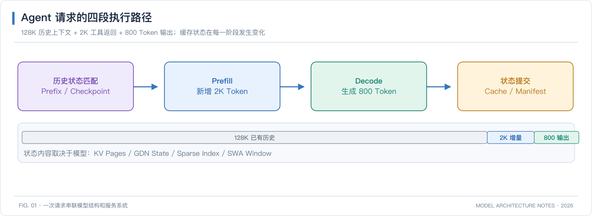
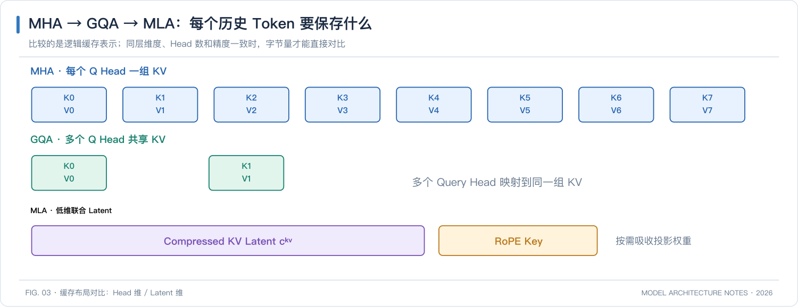
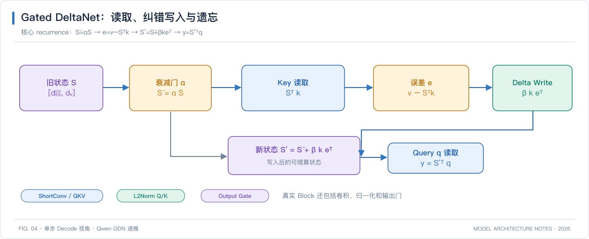
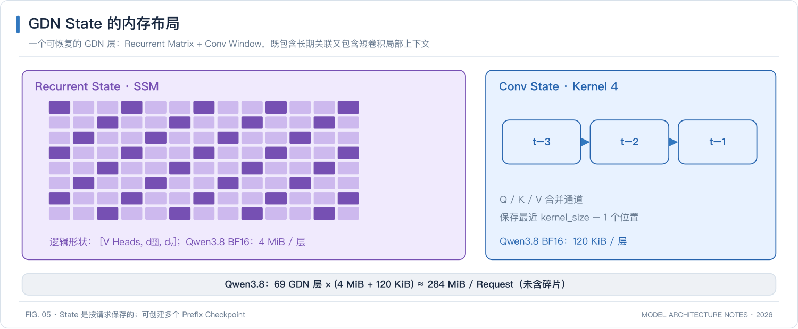
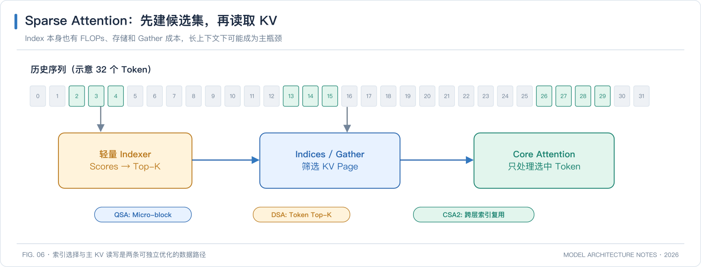
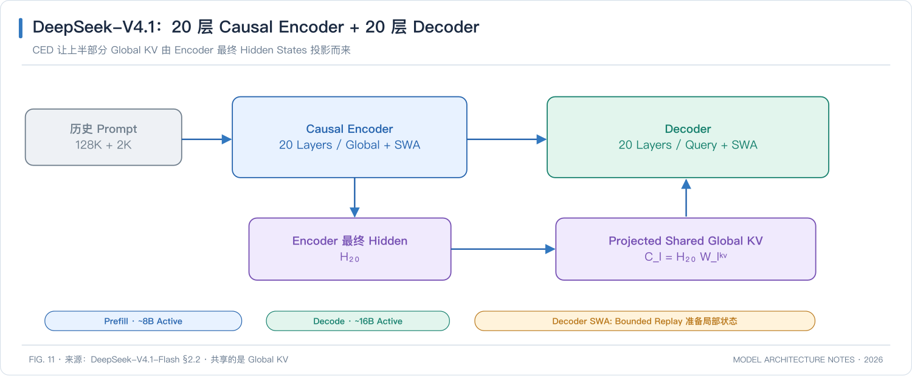
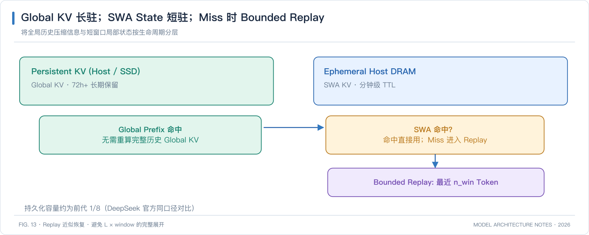
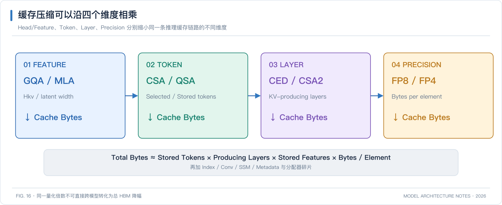

## 太长不看（TL;DR）

近两年大模型论文提出了大量新的模块缩写（GQA、MLA、GDN、KDA、DSA、QSA、CSA2、CED），但如果从推理系统（Serving Infra）的视角看，**围绕 Attention 的结构演进其实只有两条主线——Linear Attention（线性循环状态）和 Sparse Attention（稀疏注意力），或是两者的按层混合**：

1. **主线一：Linear / Recurrent 路线（GDN、KDA）——将变长历史压缩为固定维度的状态矩阵**。不再为每个历史 Token 保存独立的 K/V，而是维护一个固定形状的状态矩阵 $S_t \in \mathbb{R}^{d_k \times d_v}$ 和短卷积窗口。无论上下文是 4K 还是 1M，单层单请求的状态体积恒定。**工程上有三个直接后果**：第一，固定维度的有损压缩在长距离精确检索（Exact Retrieval）上弱于全注意力，因此 Qwen3.8 和 GLM-5.3-Flash 均保留了约 1/4 的全局或稀疏 Attention 层（3:1 混合）；第二，**在短上下文、高并发场景下，固定状态反而更占显存**——哪怕输入只有 200 个 Token，Qwen3.8 的 69 层 GDN 也要固定分配 284 MiB 状态空间，线上往往是 `Recurrent State Pool` 先于 `KV Pool` 耗尽；第三，循环状态是全前缀耦合的，无法像 PagedAttention 那样按 16-Token 页任意切分复用，未命中 Checkpoint 边界时必须重放（Replay）增量 Token。
2. **主线二：Sparse + KV 压缩路线（MLA + DSA / QSA / CSA2 / CED）——保留逐 Token 缓存，但压缩单条维度、裁剪读取位置并跨层共享**。以 DeepSeek 和 GLM 基座为代表：先用 MLA + FP8/FP4 将单 Token 的 KV 字节数压缩一个数量级；再用轻量 Indexer 在主 Attention 前筛选 Top-$K$ 历史位置，减少 HBM 带宽读取；DeepSeek-V4.1 进一步引入 **CED（前 20 层 Encoder 统一产出后 20 层 Decoder 的 Global KV）+ CSA2（跨层复用 KV 与 Top-K 索引）**，同时削减生产 KV 的层数和持久化的状态体积。**这条路线的瓶颈在于算子与访存连续性**：主 Attention 的计算量下降后，Indexer 打分、Top-K 排序和非连续内存 Gather 成为新的开销来源，必须配合块级粒度（Micro-block）或定制融合算子（如 FlashMLA）。
3. **MoE 与 Engram/N-gram 位于另一条正交维度——参数激活与静态知识查表**。Attention 决定如何访问请求的历史状态，MoE 决定每个 Token 激活哪些 FFN 权重，而 DeepSeek 的 Engram 与 Qwen-Next 的 N-gram Embedding 则将高频静态模式剥离为可驻留 Host 内存的查找表，减少主干网络的无效参数访问。
4. **推理缓存从单一的 `Paged KV Pool` 演进为多类型状态管理**。混合架构的单个请求同时包含 `Full/Latent KV Pages`、`GDN/KDA Recurrent State`、`Conv State`、`Sparse Indexer Cache` 和 `SWA 局部窗口`。不同状态的体积、生命周期和重算代价差异很大，缓存管理器需要分别制定驻留与按需重放（Bounded Replay）策略。

### Linear 与 Sparse 两条技术主线对比

| 对比维度 | 主线一：Linear / Recurrent（GDN / KDA） | 主线二：Sparse + 压缩 KV（MLA + DSA / QSA / CSA2） | 混合架构折中（Qwen3.8 / GLM-5.3-Flash） |
|---|---|---|---|
| **核心机制** | 用 Delta Rule 动态更新固定维度的状态矩阵 $S_t$，不保留逐 Token K/V | 保留逐 Token（或块）的压缩 Latent KV，查询时先由 Indexer 筛选 Top-$K$ | 3 层 Linear 吸收局部与中程上下文 + 1 层全局/稀疏 Attention 负责精确检索 |
| **单请求状态随长度 $L$ 的增长** | **$O(1)$ 恒定**（仅取决于层数与 Head 维度，与 $L$ 无关） | **$O(L)$ 线性增长**（通过 MLA 低秩投影 + FP4/FP8 + 跨层共享压低系数） | 固定状态底座（State Pool）+ 低斜率线性增长（少量 Attention 层 KV） |
| **Decode 每步访存复杂度** | **$O(1)$**，仅读写当前层的固定矩阵 $S_t$ | **$O(K)$**（主注意力仅读取选中的 $K$ 个位置，Indexer 扫描轻量索引） | 75% 的层执行 $O(1)$ 矩阵更新，25% 的层执行 $O(L)$ 或 $O(K)$ 检索 |
| **短请求高并发 vs 超长上下文** | 长序列节省显存；短序列高并发下固定状态开销占比高 | 短序列开销极小；超长序列受限于总 KV 容量与 Indexer 扫描耗时 | 需拆分为 `KV Pool` + `State Pool` 独立管理，防止短请求占满 State Pool |
| **Prefix Cache 与 PD 分离迁移** | 状态依赖完整前缀，只能在固定 Checkpoint 边界恢复，差值部分需 Replay | 按 Token Page 哈希寻址，任意页边界可拼接、可按层流水线搬运 | 跨节点迁移需同时对齐 KV 页表、最近一次 State Checkpoint 与尾部增量重放 |
| **主要代价与局限** | 远距离精确复制与多键值冲突下易发生状态覆写 | Indexer 漏召回会影响生成质量；非连续 Gather 依赖定制 Kernel | 依赖 1:3 穿插的 Attention 层保障精确检索，训练需配合蒸馏与门控稳定 |

### 主流模型架构对比


| 模型 | 总参数 / 激活参数 | 层级排布（Token Mixer） | 每请求历史状态形态 | MoE 与辅助结构 | 推理系统关注点 |
|---|---|---|---|---|---|
| **Qwen3.8-2.4T-A95B** | 2.4T / 95B | 92 层：`23 × [3 GDN + 1 Gated Full Attn]` | 69 层 GDN State（固定 **284 MiB**）+ 23 层 GQA KV（**46 MiB / 1K Token**，FP8） | 512 Experts（Top-10 + 1 Shared），MTP | 3:1 Linear/Full 混合；短请求高并发受限于 284 MiB/req 的 GDN 固定状态 |
| **Qwen3.8-Flash-Next** | 研究原型 | GDN + **QSA（微块稀疏注意力）** | GDN State + Micro-block 稀疏 KV | 四路 Gated Residual + **51B Host N-gram 表** | 用块级 AvgPool 降低 Indexer 成本；高频静态特征拆至 CPU 内存异步查表 |
| **GLM-5.3-Flash** | 320B / 18B | 45 层：`11 × [3 KDA + 1 Sparse MLA] + 1 KDA` | 34 层 KDA State + 11 层 Sparse MLA KV + **IndexPool（4 合 1）** | 288 Experts（Top-8 + 1 Shared，前 3 层 Dense），mHC | 同时融合 KDA 与 Sparse MLA；SGLang 需分别配置 KV Pool 与 KDA State Pool |
| **DeepSeek-V4.1-Flash** | 552B / Prefill 8B, Decode 16B | 40 层：**20 Causal Encoder + 20 Decoder（CED + CSA2）** | **FP4 Global KV（约 890 B/Token）** + Host 短驻 SWA KV | Engram 条件记忆（196B）+ Single-Pass mHC + DSpark | 上半段 Decoder 免完整 Prefill；局部窗口不落持久盘，通过 **Bounded Replay** 按需重建 |
| **gpt-oss-120b**（OpenAI 公开参照） | 116.8B / 5.1B | 36 层：Full GQA 与 Local Window（128）交替 | 标准 GQA KV Pages + 128 窗口局部 KV | 128 Experts（Top-4），MXFP4 权重量化 | 全注意力 + 滑动窗口 + MoE 公开基线 |

---

## 1. 128K 长上下文请求的四个系统瓶颈

假设一个 Research Agent 已经执行了多轮工具调用，历史上下文累计到 128K Token；本轮工具返回 2K Token 的检索结果，模型需要继续生成 800 Token。在分离式推理集群中，该请求依次经历四个阶段：**恢复可复用的历史状态 → Prefill 新增的 2K Token → Decode 800 个输出 Token → 提交本轮新增状态**。



对于传统的 MHA/GQA Transformer，在 128K 上下文长度下，推理开销集中在四个环节：
1. **Prefill 计算量**：若前缀缓存未命中，128K Token 需重新经过所有层的 Attention 计算，二次方复杂度直接推高首 Token 延迟（TTFT）。
2. **Decode 访存带宽**：Decode 每生成一个 Token，所有层都需要从 HBM 读取前序 128K 个位置的 K/V，延迟完全受限于显存带宽。
3. **显存与内存驻留容量**：大量处于工具等待或审批等待状态的并发 Agent 会持续占用 HBM 与 Host DRAM 容量。
4. **跨节点传输体积**：在 PD 分离架构下，Prefill 节点需要将生成的状态通过 RDMA 传输给 Decode 节点。

围绕这四个瓶颈，近年来的模型结构演进主要在四个位置做减法：


- **压缩单 Token 的 KV 维度（GQA → MLA → FP4）**：保留逐 Token 寻址，将单个 Token 存储的字节数压缩 80%～95%。
- **改变历史状态的表示形式（Linear Attention → DeltaNet → GDN / KDA）**：取消逐 Token KV 表，将变长历史压缩进固定大小的二维状态矩阵。
- **裁剪单次注意力读取的位置（DSA / QSA / CSA2）**：保留完整或压缩的 KV，但在主 Attention 前用轻量 Indexer 筛选 Top-$K$ 位置，跳过其余位置的 HBM 读取。
- **跨层共享 KV 与索引（IndexShare / CED / CSA2 Reuse）**：由底层或特定层集中生成 Global KV 与 Top-$K$ 索引，后续层直接复用，减少重复计算与存储层数。

---

## 2. Transformer Block 的三个正交改造维度

单个 Transformer Block 的结构改进分布在三个相互正交的维度上：


1. **Token Mixer（序列维如何访问历史）**：GQA、MLA、GDN/KDA、Sparse Attention 均位于这一层，直接决定**请求级状态（Request State）**的张量形态及其随序列长度的增长关系。
2. **Channel Mixer（特征维如何激活参数）**：Dense FFN 或 MoE。它不产生跨 Token 的历史状态，但决定 Decode 阶段需要从 HBM 读取多少专家权重，以及是否需要跨 GPU 执行 All-to-All 通信。
3. **Residual 与条件静态记忆（层间连接与参数化查表）**：例如 GLM 和 DeepSeek 使用的 **mHC（Manifold-Constrained Hyper-Connections）**、Qwen-Next 的 **Gated Residual**，用于稳定深层混合网络的训练；而 **Engram / N-gram Embedding** 则将高频词组特征剥离为大容量外部查找表。这类查找表属于所有请求共享的只读模型参数，与请求私有的 KV/State 生命周期完全分离。

---

## 3. 逐 Token KV 压缩：从 GQA 到 MLA

在保留逐 Token 寻址的前提下，降低 KV Cache 体积的第一步是减少每个 Token 保存的元素数量。

### 3.1 GQA 减少头组数，MLA 投影至低秩空间

标准多头或分组注意力（MHA / GQA）的逻辑 KV 容量为：

$$B_{KV}=L\cdot N_{\mathrm{layers}}\cdot 2\cdot H_{KV}\cdot d_h\cdot b.$$

以 32 层、8 个 KV Head、Head Dim 128、BF16（2 Bytes）为例，单 Token 的逻辑 KV 为 `128 KiB`，128K 上下文占 **16 GiB**（FP8 下为 8 GiB）。Qwen3.8 的 23 个全注意力层采用 16:1 GQA（64 个 Q Head 共享 4 个 KV Head，Head Dim 256），将单层单 Token 的 FP8 KV 降至 `4 × 256 × 2 × 1 B = 2 KiB`。



DeepSeek-V2/V3 提出的 **MLA（Multi-head Latent Attention）** 则将所有 Head 的 K 和 V 联合投影到一个低维潜在向量 $c_t^{KV}$：

$$c_t^{KV}=W_{DKV}h_t,\qquad K_t=W_{UK}c_t^{KV},\quad V_t=W_{UV}c_t^{KV}.$$

缓存池中每个 Token 每层只需保存 512 维的 $c_t^{KV}$ 和 64 维的解耦 RoPE 位置向量（共 576 个元素）。

在推理执行时，MLA 依赖 **Weight Absorption（权重吸收）** 避免显式展开全尺寸 K/V：

$$q_t^\top (W_{UK}c_j^{KV})=(W_{UK}^\top q_t)^\top c_j^{KV}.$$

通过矩阵乘法结合律，将上投影矩阵 $W_{UK}^\top$ 提前合并到当前步的 $q_t$ 上，历史缓存读出后直接与变换后的 Query 做内积。正如 [SGLang HiCache 解析](/posts/sglang-hicache/#ch10) 中所分析的，由于 $c_t^{KV}$ 在按 Head 切分前就已经算出，所有 TP Rank 上的 Latent KV 完全一致，跨机备份时仅需 Rank 0 写入一份数据。

---

## 4. 主线一：Linear / Recurrent（GDN 与 KDA）——固定维度的历史状态矩阵

即便采用 MLA，只要保留逐 Token KV，缓存容量仍随序列长度 $L$ 线性增长。面向百万 Token 级上下文，另一条主线是**不再保留逐 Token KV 表，改用固定维度的循环状态矩阵 $S_t$**。

### 4.1 从朴素 Linear Attention 到 GDN 的门控 Delta 更新

基础 Linear Attention 去掉了 Softmax，直接将历史 $k_t v_t^\top$ 的外积累加到形状为 $d_k \times d_v$ 的状态矩阵 $S_t$ 中：

$$S_t\in\mathbb{R}^{d_k\times d_v},\qquad S_t=S_{t-1}+k_tv_t^\top,\qquad y_t=S_t^\top q_t.$$

早期 Linear Attention 表达能力受限的核心原因在于：**该更新公式只有累加，没有定向擦除**。当序列变长时，相似 Key 对应的不同历史 Value 会叠加在同一块矩阵空间内，模型难以覆盖过期的键值关联。

为解决旧状态残留问题，**DeltaNet** 引入了 Delta Rule（误差修正更新）：写入新信息前，先计算当前 Key 在旧状态上的预测值 $S_{t-1}^\top k_t$，求出它与当前目标 $v_t$ 的差值 $e_t$，再按差值更新矩阵。在此基础上，**GDN（Gated DeltaNet）** 与 GLM 采用的 **KDA（Kimi Delta Attention）** 进一步加入了遗忘衰减门 $\alpha_t$：

$$\begin{aligned}
\widetilde S_{t-1}&=\alpha_t S_{t-1} \quad &&\text{（1. 按衰减门 }\alpha_t\text{ 缩放旧状态）}\\
e_t&=v_t-\widetilde S_{t-1}^{\top}k_t \quad &&\text{（2. 读取当前 Key 的旧预测值并计算残差）}\\
S_t&=\widetilde S_{t-1}+\beta_t k_t e_t^{\top} \quad &&\text{（3. 按写入强度 }\beta_t\text{ 修正状态矩阵）}\\
y_t&=S_t^{\top}q_t \quad &&\text{（4. 用当前 Query 读取输出）}
\end{aligned}$$



单步 Decode 的核心计算如下：

```python
# 单个 GDN Head 的核心更新逻辑（省略输入投影、短因果卷积与输出门）
# S 形状固定为 [d_k, d_v]，不随序列长度 L 增长
def gdn_step(q, k, v, S, alpha, beta):
    old_state = alpha * S                        # 门控衰减
    error = v - (old_state.T @ k)                # 计算预测残差
    new_state = old_state + beta * outer(k, error)  # 增量修正状态矩阵
    output = new_state.T @ q
    return output, new_state
```

Prefill 与 Decode 在算子实现上存在明显差异：Decode 阶段按单 Token 串行更新 $S_t$；Prefill 阶段若按 Token 逐个启动 CUDA Kernel 会被启动延迟拖慢，因此必须使用 **Chunkwise Parallel（分块并行融合算子，如 FLA / FlashQLA）**——在 64 或 128 Token 的块内做矩阵并行计算，仅在块间串行传递状态 $S$。

### 4.2 显存开销定量对比：为什么短请求高并发下 GDN 反而更占显存？

在实际模型中，每层 GDN 需要保存两部分请求状态：循环矩阵 `SSM State`（即 $S_t$）和短因果卷积滑动窗口 `Conv State`（保存最近 `kernel_size - 1` 个 Token 的输入）。



按 **Qwen3.8-2.4T-A95B** 在 vLLM 中的公开部署配置（BF16 State）计算 [1, 3]：
- **单层 `SSM State`**：`128 value heads × 128 value dim × 128 key dim × 2 Bytes = 4 MiB`；
- **单层 `Conv State`**：`(2 × 16 × 128 + 128 × 128) × (4 - 1) × 2 Bytes = 120 KiB`；
- **69 层 GDN 合计**：每个请求固定占用 **$69 \times 4.117\,\text{MiB} \approx 284\,\text{MiB}$**。

同模型中的 23 层 Full Attention（FP8 KV）每层每 Token 占 `2 KiB`，23 层合计**每 1K Token 占 46 MiB**。因此单个请求的总状态容量为：

$$B_{\text{Qwen3.8}}(L) = \underbrace{284\,\text{MiB}}_{\text{69 层 GDN 固定状态}} + \underbrace{46\,\text{MiB} \times \frac{L}{1024}}_{\text{23 层 Full Attention 线性增量}}.$$

这组定量关系直接决定了混合模型的容量边界：
- 当上下文 $L = 128\text{K}$ 时，284 MiB 的 GDN 状态仅相当于约 6K Token 的 Full Attention KV，大幅降低了长序列显存占用；
- **当工作负载是 $L = 512$ 的短请求高并发时**，23 层 Full Attention 仅占 23 MiB，而 69 层 GDN 仍需固定分配 284 MiB。因此，在 SGLang 和 vLLM 中部署 Qwen3.8 或 GLM-5.3-Flash 时，若仅监控 KV Token Pool，往往 KV 池仍有大量余量，系统并发上限（`max_running_requests`）就先被 `GDN/KDA State Pool` 限制住了。

### 4.3 Prefix Caching 与投机解码的适配难点

传统 KV Cache 的每个 Token 位置相互独立，RadixAttention 可以按 16-Token Page 任意切分和共享前缀。

而 GDN 的状态矩阵 $S_t$ 是整段前缀递推计算的结果：
- **无法在任意 Token 位置切片恢复**：若缓存池仅在第 8192 Token 处保存了 State 快照，而新请求命中了前 10000 个 Token 的文本前缀，系统无法直接截取得到 $S_{10000}$，必须先加载 $S_{8192}$，再将第 $8193 \sim 10000$ 这 1808 个 Token 重新执行一遍增量重放（Replay）。
- **投机解码（Speculative Decoding）状态回滚**：传统 KV Cache 在草稿 Token 被拒绝时只需回退有效长度指针；GDN 的状态矩阵已被原地修改，回滚要么在验证前备份整块 284 MiB 状态，要么只能在确认接受的 Token 边界提交状态。

---

## 5. 主线二：Sparse Attention（DSA、QSA、CSA2）——Indexer 筛选与跨层复用

另一条主线保留了逐 Token（或块级）的 KV 存储，但在每次注意力计算前通过稀疏索引裁剪读取范围：

$$\mathcal I_t=\operatorname{TopK}\!\left(\operatorname{Indexer}(q_t,K_{\mathrm{index}})\right),\qquad
o_t=\operatorname{Attention}\!\left(q_t,K[\mathcal I_t],V[\mathcal I_t]\right).$$



评估 Sparse Attention 的实际收益，不能只看主 Attention 节省的 FLOPs，必须同时计入 **`Indexer 打分 + TopK 排序 + 非连续内存 Gather`** 的附加开销。主流模型通过三种方式降低这部分索引成本：

1. **低精度轻量 Indexer 与跨层索引共享（DeepSeek DSA / GLM IndexShare）**：主 Attention 读取 512 维的 MLA Latent，而 Indexer 使用低维、低精度的索引向量计算相关性；GLM-5.3 的 **IndexShare** 让相邻多层直接共享同一组 Top-$K$ 选中下标，仅在特定层执行 Indexer 计算 [4]。
2. **微块池化缩减检索项数（Qwen QSA / GLM IndexPool）**：在 1M 上下文下，逐 Token 扫描索引依然昂贵。Qwen3.8-Flash-Next 的 **QSA** 将相邻 $r$ 个 Token 划分为一个 Micro-block，先通过 AvgPool 与 RMSNorm 聚合成单个块级 Key（在池化后再施加位置编码，避免不同旋转相位的向量相互抵消）[2]；GLM-5.3-Flash 的 **IndexPool** 同样将 4 个历史 Indexer Key 聚合成 1 个汇总项，将索引扫描长度缩减至 1/4 [5]：

$$\hat k_b=\mathrm{RMSNorm}\!\left(\operatorname{AvgPool}(k_{br:\,(b+1)r})\right).$$

综合维度压缩（MLA）、序列稀疏（Sparse）和层间复用（Layer Reuse），长请求需要持久化的全局缓存容量可表示为：

$$B_{\mathrm{global}}\approx N_{\mathrm{stored\_tokens}}\cdot N_{\mathrm{KV\_producers}}\cdot d_{\mathrm{stored}}\cdot b\; +\; B_{\mathrm{index}}+B_{\mathrm{metadata}}.$$

---

## 6. 正交维度：MoE 路由与跨 GPU 通信

在 Channel Mixer 维度，**MoE（Mixture of Experts）** 通过稀疏激活扩大总参数规模：

$$y_t=\sum_{e\in\operatorname{TopK}(r(h_t))}p_{t,e}\,\mathrm{FFN}_e(h_t)+\mathrm{FFN}_{\mathrm{shared}}(h_t).$$


在 **EP（Expert Parallelism，专家并行）** 部署下，单层 MoE 依次执行 `Router 打分 → Top-K 选择 → All-to-All Dispatch → Expert GEMM → All-to-All Combine`。每 Token 激活参数量（如 18B 或 95B）并不能直接换算为推理延迟，实际吞吐主要受两个因素制约：
- **中等 Batch 下的权重访存**：单请求 Decode 时仅需读取 Top-$K$ 个专家的权重；但当并发 Batch 增大到数十个 Token 时，被选中的专家并集迅速覆盖大部分路由专家，GPU 仍需从 HBM 读取接近全量的专家参数。
- **负载倾斜与 All-to-All 尾延迟**：若部分热点专家被集中选中，对应 GPU 的 GEMM 计算与通信会成为整层的慢节点，其余设备在 `Combine` 阶段等待同步。

---

## 7. Qwen3.8 系列：3:1 GDN 混合架构与 Host N-gram 表

### 7.1 Qwen3.8-2.4T-A95B：为什么保留 1/4 的全注意力层？

Qwen3.8-2.4T-A95B 共 92 层，采用 `23 × [3 × GDN + 1 × Gated Full Attention]` 的周期结构（69 层 GDN + 23 层全注意力）[1]。


固定维度的状态矩阵 $S_t$ 属于有损压缩，适合建模连续语境与局部依赖，但在长距离精确复制（如跨数万 Token 提取特定哈希值或代码标识符）上存在精度损失。每 3 层 GDN 后插入 1 层 Gated Full Attention，能够用 75% 的层降低长序列 KV 容量与访存带宽，同时由 25% 的全注意力层保留逐 Token 精确检索能力。

### 7.2 Qwen3.8-Flash-Next：QSA、四路门控残差与 51B Host 查表

研究原型 Qwen3.8-Flash-Next [2] 在 3:1 混合骨架上进一步做了三项改进：
1. 将部分全注意力层替换为 **QSA（微块稀疏注意力）**，降低全局注意力的索引开销；
2. 引入 **四分支 Gated Residual（门控残差）**，为每个残差分支配置可学习的读取门，提升深层混合网络的训练稳定性；
3. **分离 51B 参数的 N-gram Embedding 表**：将高频词组特征从主干 FFN 中剥离。由于查表索引仅依赖输入 Token 的字面 N-gram，该 51B 嵌入表可直接驻留在 **Host CPU 内存**中，分词后通过 PCIe 异步预取所需行，不占用 GPU HBM。


---

## 8. GLM-5.3 系列：KDA 循环状态与 Sparse MLA 的结合

GLM-5.3 系列包含两条架构分支 [4, 5]：
- **GLM-5.3（744B-A40B，78 层）** 沿用 **MLA + DSA + IndexShare** 架构，通过跨层共享 Top-$K$ 索引降低长上下文检索开销；
- **GLM-5.3-Flash（320B-A18B，45 层文本 + 24 层视觉）** 则将 Linear 与 Sparse 两条路线结合：前 44 层按 `11 × [3 × KDA + 1 × Sparse MLA]` 交替排列，第 45 层为 KDA。


在推理部署上，这种混合结构要求引擎同时管理两套内存池：
- SGLang 部署 GLM-5.3-Flash 时，将缓存拆分为 **`Paged KV Pool`**（服务 11 层 Sparse MLA）和 **`KDA State Pool`**（服务 34 层 KDA）[5]；
- 配合 **ReplaySSM**（状态重放算子）处理前缀恢复，并通过 **EPD（Encode–Prefill–Decode 分离）** 将 24 层 Vision Encoder 的显存峰值与文本 Decode 隔离。

---

## 9. DeepSeek-V4.1-Flash：CED 跨层共享、CSA2 与 Bounded Replay

2026 年 9 月发布的 **DeepSeek-V4.1-Flash（总参数 552B）** 展示了纯注意力路线在压缩上的极限：不引入 RNN/Linear 状态，而是通过**跨层共享、FP4 量化与局部窗口按需重放**大幅削减 KV Cache 体积 [6, 7]。

### 9.1 CED（Causal Encoder-Decoder）：削减上半段网络的 Prefill 计算

DeepSeek-V4.1-Flash 的 40 层主干分为 **20 层 Causal Encoder** 和 **20 层 Decoder**。后 20 层 Decoder 所需的长程 **Global KV（$C_l$）和索引向量（$Z_l$），并非由 Decoder 各层自身的 Hidden State 计算得出，而是统一由第 20 层 Encoder 的输出 $H_{20}$ 线性投影生成**：

$$C_l=H_{20}W^{KV}_l,\qquad Z_l=H_{20}W^Z_l,\qquad (l>20).$$



这一结构直接改变了 Prefill 与 Decode 的计算比例：
- 对长上下文执行 Prefill 时，**历史输入只需完整前向计算前 20 层 Encoder**，得出 $H_{20}$ 并投影出上层 Global KV 即可；后 20 层 Decoder 无需对全部历史 Token 逐层执行完整前向计算（仅需准备局部的滑动窗口 SWA 状态）。
- 按技术报告披露的激活参数口径，该模型在 **Prefill 阶段每 Token 激活约 8B 参数，Decode 阶段激活约 16B 参数** [6]，非常适合长工具输入、相对短输出的 Agent 负载。

### 9.2 CSA2：Full、Reindex、Reuse 三种跨层复用模式

在后 20 层 Decoder 内部，**CSA2（Compressed Sparse Attention 2）** 将各层划分为三种模式，解耦了 KV 生成、索引打分与 Top-$K$ 选择：


- **Full 层**：生成本层的 Main KV 与 Indexer K，并通过 Hierarchical Sparse Indexer（先从 1M 上下文中粗筛 2048 个 8-Token 块共 16,384 个候选位置，再细筛 Top-512）计算新的选中位置；
- **Reindex 层**：**不单独保存 Global KV**，直接复用前序 Full 层的 Main KV 和 Indexer K，仅在 16,384 个候选池内用本层 Query 重新计算 Top-512；
- **Reuse 层**：同时复用前序层的 Main KV、Indexer K 以及已选出的 Top-512 下标，本层直接执行 Sparse Attention 和局部 SWA。

### 9.3 FP4 Global KV 与 Bounded Replay：用局部窗口重算替代持久存储

在存储精度与生命周期管理上，DeepSeek-V4.1-Flash 进一步区分了全局状态与局部状态：
1. **FP4 Main KV**：通过量化感知训练，将需要长期保留的 Global Main KV 压缩至 **FP4（E2M1 + 分组 Scale）**，而对误差敏感的局部 SWA KV 保持 FP8。整模型的 **Global KV 降至约 890 Bytes / Token**（128K 上下文的理论 Global KV 约 **111 MiB**，为前代 V4-Flash 的 1/4）[6]。
2. **Bounded Replay（有界重放）**：每层的局部滑动窗口（SWA KV）不在持久化缓存池中长期保存，仅在 Host DRAM Pool 中短期驻留。当 SWA 缓存未命中时，系统仅取最近 `n_win` 个 Token 执行有界窗口重放（Bounded Replay），结合已缓存的 Global KV 快速重建局部窗口状态。



通过只持久化 Global KV、按需重放局部 SWA 状态，V4.1 的持久化缓存总占用降至 V4 的 **1/8**。此外，模型还结合了 196B 的 **Engram 条件记忆表**与 **DSpark 投机解码**。

### 9.4 闭源模型公开参照：GPT-6 / gpt-oss 与 Claude 5.5

GPT-6 与 Claude 5.5 未公开内部层数与注意力变种，但 OpenAI 开放的 **`gpt-oss-120b`**（36 层，116.8B 总参数 / 5.1B 激活参数，128 Experts Top-4，Full GQA 与 128 窗口 Local Attention 交替，MXFP4 权重量化）[8] 提供了清晰的 MoE + 局部/全局交替注意力参照基线。


---

## 10. 推理缓存演进：从单一 Paged KV 到多类型状态调度

对比 Qwen3.8、GLM-5.3-Flash 和 DeepSeek-V4.1 可以看到，**Attention 的存储优化已经从单一的 Head 维度，扩展到序列维、层维、精度维与状态生命周期**。



这对推理引擎（vLLM / SGLang / Mooncake）的直接影响是：过去"所有层统一使用等长 `Page Table` 管理连续 KV Tensor"的假设不再成立。Runtime 需要同时管理五类性质不同的状态：


```python
@dataclass
class StateManifest:
    model_revision: str
    kv_abi: str                 # 布局版本 / TP 切分 / FP8 或 FP4 scale 格式
    request_generation: int     # 防止过期 Worker 覆盖状态
    prefix_token_hash: str
    committed_token_pos: int    # 所有异构状态共同对齐的 Token 边界
    tensor_refs: dict[str, list[TensorRef]]
    # 分别索引: full_kv / mla_latent_kv / gdn_kda_ssm / conv_ring / sparse_index / swa
```

当长上下文请求从等待中恢复或跨节点迁移时，调度器需要在 **Restore（搬运恢复）** 与 **Recompute / Replay（重算重放）** 之间做耗时权衡：

$$T_{\mathrm{restore}}\approx T_{\mathrm{lookup}}+T_{\mathrm{queue}}+T_{\mathrm{network}}+T_{\mathrm{H2D}}+T_{\mathrm{install}}+T_{\mathrm{sync}},$$

$$T_{\mathrm{recompute}}\approx T_{\mathrm{schedule}}+T_{\mathrm{prefill/replay}}(L_{\mathrm{missing}},\mathrm{StateType}).$$

针对不同状态的特征，缓存管理器需要采取差异化的分级策略：
1. **全局压缩 KV（MLA Latent / FP4 Global KV）**：单 Token 字节数极小、重算成本高，且支持按页哈希去重，适合放入 L2 Host 与 L3 RDMA 持久池长期缓存。
2. **循环状态（GDN / KDA Recurrent State + Conv State）**：单次快照体积较大（如 Qwen3.8 的 284 MiB/请求），且不支持任意 Token 切片，适合在工具调用边界等关键节点做稀疏 Checkpoint，恢复时通过 Checkpoint + 尾部 Chunkwise 增量重放对齐最新位置。
3. **局部滑动窗口（SWA State）与派生索引（Reuse Top-K）**：重放窗口有界且计算开销极低，适合仅在 GPU/Host 短驻，淘汰后直接通过 Bounded Replay 按需重建，不占用远端持久化存储与 RDMA 带宽。
4. **静态条件记忆表（Engram / N-gram Embedding）**：属于跨请求共享的只读参数，常驻 Host DRAM 并按需异步预取至 GPU。

---

## 参考资料

1. [Qwen3.8-2.4T-A95B 官方 Model Card 与结构配置](https://huggingface.co/Qwen/Qwen3.8-2.4T-A95B) · [Qwen3.8 GitHub](https://github.com/QwenLM/Qwen3.8)
2. Qiu et al., [On the Design of Qwen3.8-Next Architecture: Evaluation, Efficiency, and Training Stability](https://arxiv.org/abs/2608.30320), 2026（§2.1 GDN、§2.2 QSA、§2.3 Gated Residual & N-gram Embedding）
3. vLLM Team, [PD Serving of Qwen3.8-2.4T](https://vllm-project.github.io/2026/09/21/qwen38-pd-serving.html), 2026
4. Z.ai, [GLM-5.3: Frontier Coding with Emergent Cyber Capabilities](https://z.ai/blog/glm-5.3) · [GLM-5.3-Flash: Frontier Intelligence, Flash Cost](https://z.ai/blog/glm-5.3-flash), 2026
5. [GLM-5.3-Flash 官方 config.json](https://huggingface.co/zai-org/GLM-5.3-Flash/blob/main/config.json) · [SGLang GLM-5.3-Flash 部署指南](https://github.com/sgl-project/sglang/blob/main/docs/cookbook/autoregressive/GLM/GLM-5.3-Flash.mdx)
6. DeepSeek-AI, [DeepSeek-V4.1-Flash: Pushing the Limits of KV Cache Compression](https://arxiv.org/abs/2609.19969), 2026（§2.2 CED、§2.3 CSA2、§3.2 Bounded Replay）
7. [DeepSeek-V4.1-Flash 官方 Model Card](https://huggingface.co/deepseek-ai/DeepSeek-V4.1-Flash)
8. OpenAI, [gpt-oss Model Card](https://deploymentsafety.openai.com/gpt-oss) · [GPT-6 and Intelligent UI for everyone](https://openai.com/index/gpt-6-for-everyone/), 2026
9. Anthropic, [Introducing Claude Opus 5.5](https://www.anthropic.com/claude-opus-5-5), 2026
10. [SGLang HiCache 解析](/posts/sglang-hicache/)
