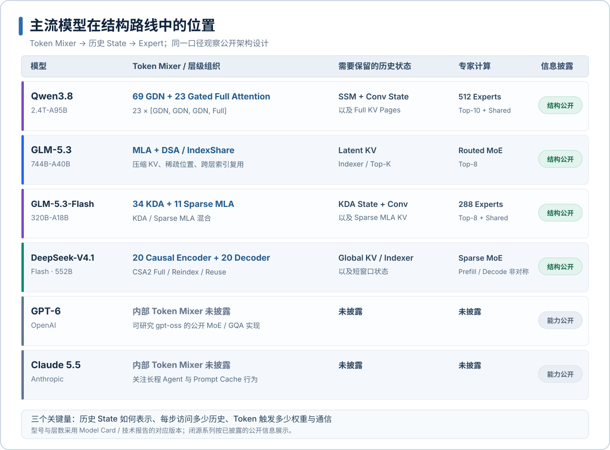
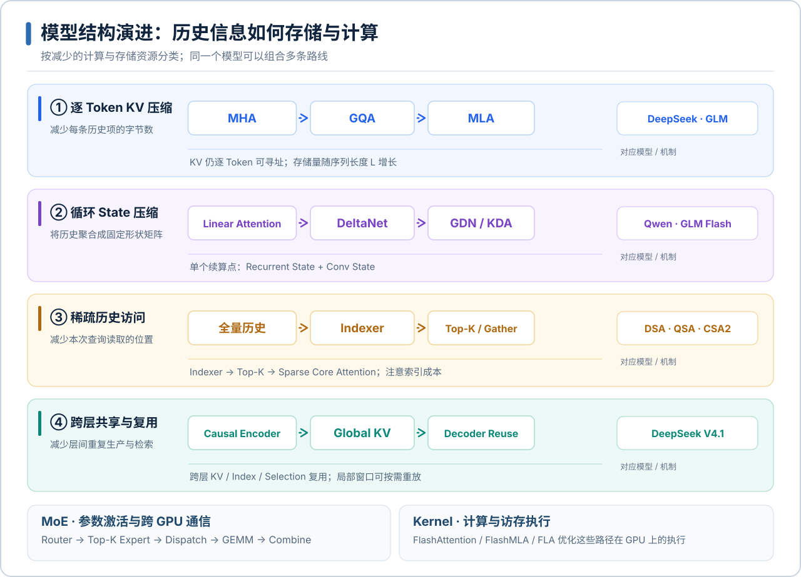
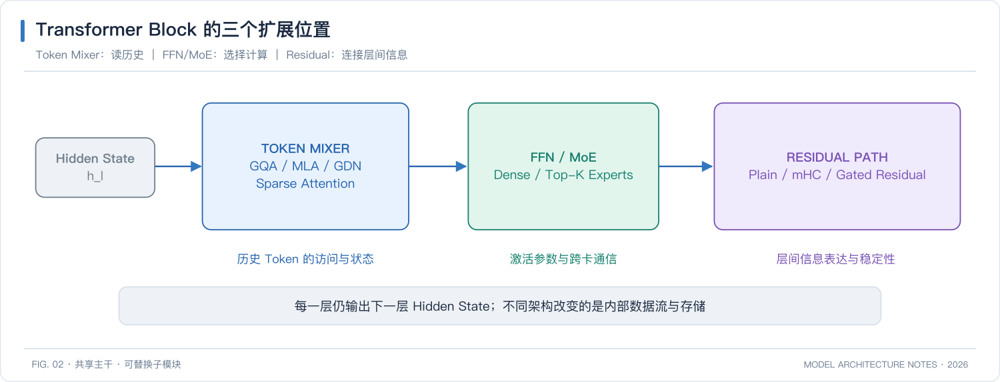
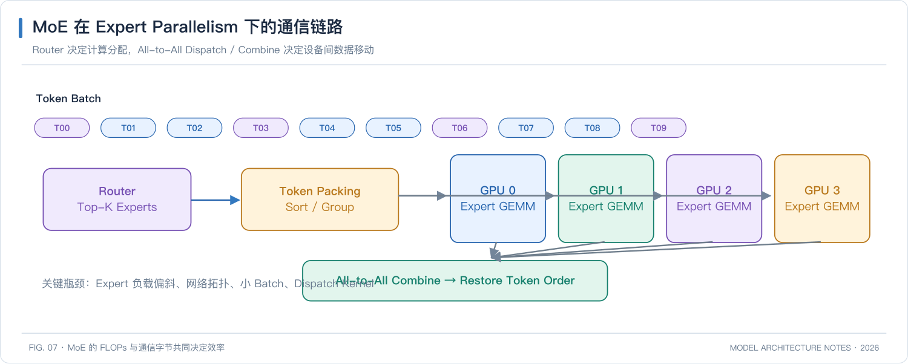
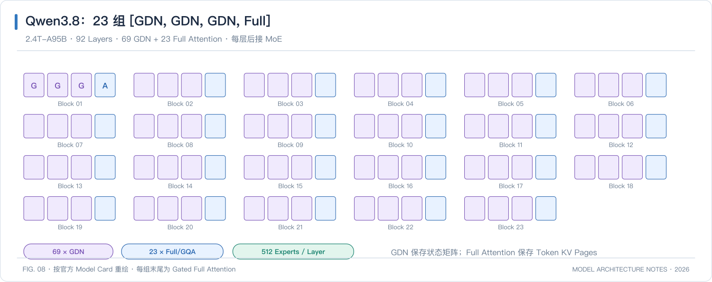
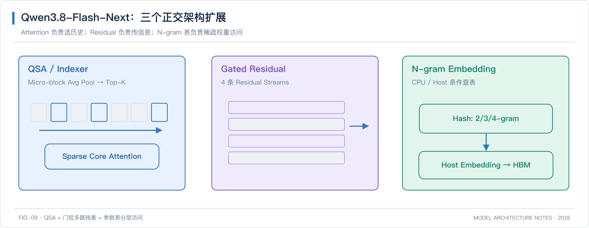
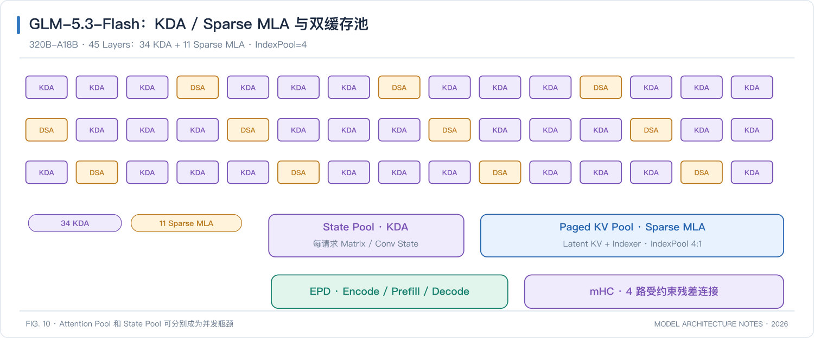
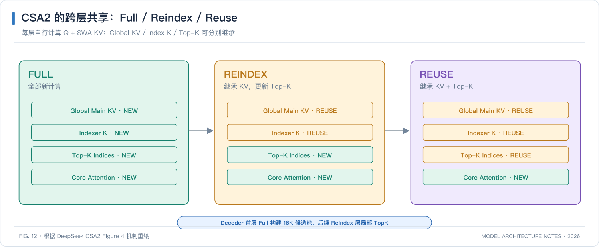
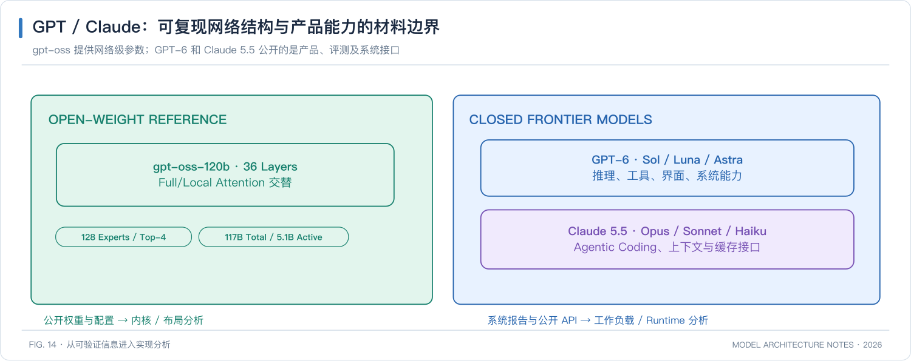
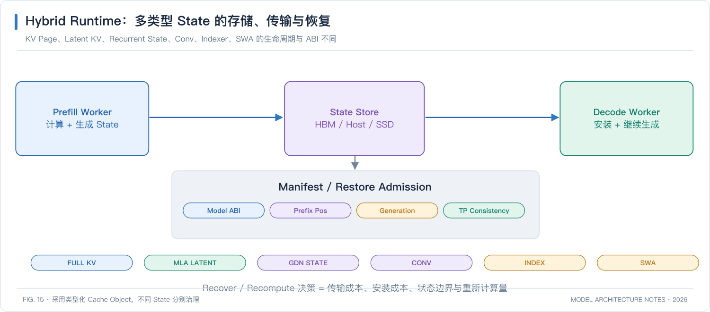

## 太长不看（TL;DR）

这几年大模型论文里的架构缩写层出不穷（GQA、MLA、GDN、KDA、DSA、QSA、CSA2、CED……），但如果站到推理系统（Serving Infra）的视角把包装剥掉，**所有前沿架构围绕 Attention 做的事情只有两条主线——要么走 Linear（线性循环状态），要么走 Sparse（稀疏历史检索），或者把两者按层混排**：

1. **主线一：Linear / Recurrent 路线（GDN、KDA）——「把无限历史压进定长矩阵，拿大海捞针精度换 $O(1)$ 状态体积」**。不再为每个历史 Token 保留独立 K/V，而是维护一个固定形状的状态矩阵 $S_t \in \mathbb{R}^{d_k \times d_v}$（外加短卷积环）。不管上下文是 4K 还是 1M，单层单请求的状态大小恒定。**但它绝不是免费的午餐**：第一，纯线性状态做不好跨长文精确抄写（大海捞针），所以 Qwen3.8 和 GLM-5.3-Flash 全都得保留 1/4 左右的全局/稀疏 Attention 层兜底（3:1 混合）；第二，**在短上下文、高并发场景下，它反而更费显存**——哪怕请求只有 200 个 Token，Qwen3.8 的 69 层 GDN 也要雷打不动划走 284 MiB 状态空间，上线时往往是 `Recurrent State Pool` 先于 `KV Pool` 被并发请求打爆；第三，它的状态是全前缀耦合的，没法像 PagedAttention 那样按 16-Token 页任意切分复用，没对齐 Checkpoint 边界就得重放（Replay）增量 Token。
2. **主线二：Sparse + KV 压缩路线（MLA + DSA / QSA / CSA2 / CED）——「保留逐 Token 账本，但压扁单条体积、只挑 Top-K 位置读、跨层白嫖索引」**。以 DeepSeek 和 GLM 基座为代表：先用 MLA + FP8/FP4 把单 Token 的 KV 字节数砍掉一个数量级；再用轻量 Indexer 在主 Attention 前筛出 Top-$K$ 历史块，省掉无效 HBM 带宽搬运；到了 DeepSeek-V4.1，甚至用 **CED（前 20 层 Encoder 统一产出后 20 层 Decoder 的 Global KV）+ CSA2（跨层复用 KV 与 Top-K 索引）**，连层与层之间的重复计算和持久存储都砍掉了。**它的核心代价在于硬件亲和性**：省掉了主 Attention 的 FLOPs，但多出了 Indexer 打分、Top-K 排序和非连续内存 Gather——如果块粒度太碎或没有 FlashMLA 这类定制融合算子，省下来的计算时间全会赔在访存碎片上。
3. **MoE 与 Engram/N-gram 解决的是另一条正交轴——「参数激活与条件查表」**。Attention 管的是「怎么读请求历史（State）」，MoE 管的是「每个 Token 激活哪几块 FFN 权重」，而 DeepSeek 的 Engram / Qwen-Next 的 N-gram Embedding 则是把高频死记硬背的静态知识剥离成可放 Host 内存的大号 Hash 查找表，不占宝贵的 GPU GEMM 算力。
4. **对推理引擎最直接的冲击：统一的 `Paged KV Pool` 时代结束了**。以前 vLLM / SGLang 只要管好一种固定页大小的 KV 池就能通吃所有模型；现在一个混合架构请求同时拖着 `Full/Latent KV Pages`、`GDN/KDA Recurrent State`、`Conv Ring`、`Sparse Indexer Cache` 和 `SWA 局部窗口` 五种生命周期截然不同的状态。未来的推理缓存管理器，本质上是一个**多类型状态的 Checkpoint 与按需重放（Bounded Replay）调度器**。

### 两条技术主线正面对比

| 对比维度 | 主线一：Linear / Recurrent（GDN / KDA） | 主线二：Sparse + 压缩 KV（MLA + DSA / QSA / CSA2） | 混合架构工程折中（Qwen3.8 / GLM-5.3-Flash） |
|---|---|---|---|
| **核心思想** | 用 Delta Rule 动态擦写固定维度的状态矩阵 $S_t$，丢弃逐 Token 明细 | 保留逐 Token（或块）的压缩 Latent KV，查询时先用 Indexer 筛出 Top-$K$ | 3 层 Linear 负责低成本吸收局部与中程上下文 + 1 层全局/稀疏 Attention 负责精确回溯 |
| **单请求状态随长度 $L$ 的增长** | **$O(1)$ 恒定**（仅取决于层数与 Head 维度，与 $L$ 无关） | **$O(L)$ 线性增长**（通过 MLA 低秩投影 + FP4/FP8 + 跨层共享极力压低斜率） | $\text{固定底座（State Pool）} + \text{低斜率线性增长（少量 Attention 层 KV）}$ |
| **Decode 每步访存复杂度** | **$O(1)$**，只读写当前层的固定矩阵 $S_t$ | **$O(K)$**（主注意力只读选中的 $K$ 个位置，但 Indexer 仍需扫轻量索引） | 75% 的层走 $O(1)$ 矩阵更新，25% 的层走 $O(L)$ 或 $O(K)$ 检索 |
| **短请求高并发 vs 超长上下文** | **长文省显存，短文反吃亏**（100 Token 请求也得占满整块 State） | **短文极省，超长文受限于总 KV 容量与 Indexer 扫描开销** | 必须拆成 `KV Pool` + `State Pool` 双池独立配额，防短请求把 State 池撑爆 |
| **Prefix Cache 与 PD 分离迁移** | **难**：状态是整段前缀的函数，只能在固定 Checkpoint 边界恢复，中间差值需 Replay | **天然友好**：按 Token Page 哈希寻址，任意页边界可拼接、可按层流水线搬运 | 跨节点迁移必须同时对齐「KV 页表 + 最近一次 State Checkpoint + 尾部增量重放」 |
| **能力短板** | 跨十万字精确复制、多重键值冲突时容易发生「状态覆写遗忘」 | Indexer 漏召回（Recall Miss）则主 Attention 彻底瞎眼；非连续 Gather 考验算子 | 靠 1:3 穿插的全注意力层补齐精确检索，训练期需专门做块蒸馏与门控稳定 |

### 2026 主流前沿模型架构定位总览



| 模型 | 总参 / 激活参数 | 层级排布（Token Mixer） | 历史状态形态（每请求） | MoE 与辅助结构 | 核心工程看点 |
|---|---|---|---|---|---|
| **Qwen3.8-2.4T-A95B** | 2.4T / 95B | 92 层：`23 × [3 GDN + 1 Gated Full Attn]` | 69 层 GDN State（约 **284 MiB 固定**）+ 23 层 GQA KV（**46 MiB / 1K Token**，FP8） | 512 Experts（Top-10 + 1 Shared），MTP | 典型 3:1 Linear/Full 混合；短请求并发受限于 284 MiB/req 的 GDN 固定状态 |
| **Qwen3.8-Flash-Next** | 研究原型 | GDN + **QSA（微块稀疏注意力）** | GDN State + Micro-block 稀疏 KV | 四路 Gated Residual + **51B Host N-gram 表** | 用块级 AvgPool 降 Indexer 成本；把高频死知识拆到 CPU 内存查表 |
| **GLM-5.3-Flash** | 320B / 18B | 45 层：`11 × [3 KDA + 1 Sparse MLA] + 1 KDA` | 34 层 KDA State + 11 层 Sparse MLA KV + **IndexPool（4 合 1）** | 288 Experts（Top-8 + 1 Shared，前 3 层 Dense），mHC | 同时融合 Linear（KDA）与 Sparse MLA两条线；SGLang 需双池独立管理 |
| **DeepSeek-V4.1-Flash** | 552B / Prefill 8B, Decode 16B | 40 层：**20 Causal Encoder + 20 Decoder（CED + CSA2）** | **FP4 Global KV（约 890 B/Token）** + Host 短驻 SWA KV | Engram 条件记忆（196B）+ Single-Pass mHC + DSpark | **最激进的跨层共享**：上半段免完整 Prefill，局部窗口不落持久盘而是靠 **Bounded Replay** 按需重算 |
| **gpt-oss-120b**（OpenAI 公开参照） | 116.8B / 5.1B | 36 层：Full GQA 与 Local Window（128）交替 | 标准 GQA KV Pages + 128 窗口局部 KV | 128 Experts（Top-4），MXFP4 权重量化 | 经典的「全注意力 + 滑动窗口」基线，适合作为 MoE + GQA 的复现实验标尺 |

---

## 1. 一条 128K Agent 请求的「算、读、存、搬」四笔账

假设一个深度研究 Agent 已经跑了十几轮工具调用，历史上下文攒到了 128K Token；本轮工具刚返回 2K Token 的网页内容，模型需要接着生成 800 Token 的分析。在分离式推理集群里，这轮请求要走完四步：**恢复历史缓存 → Prefill 新增的 2K Token → 自回归 Decode 800 步 → 提交新增状态**。


如果底层还是传统的 MHA/GQA Transformer，到了 128K 这个长度，系统会被四笔账同时卡脖子：
1. **算多少（Prefill 计算量）**：一旦前缀缓存没命中，128K Token 重新过一遍全层 Attention，二次方复杂度直接拉爆首字延迟（TTFT）。
2. **读多少（Decode 访存带宽）**：Decode 每吐 1 个 Token，所有层都要把前面 128K 个位置的 K/V 从 HBM 里硬读一遍，GPU 计算单元全在等显存带宽。
3. **存多少（驻留容量）**：几百个处于「等工具返回」状态的并发 Agent 挂在集群里，HBM 和 Host DRAM 能塞下多少条长上下文？
4. **搬多少（PD 分离与跨机恢复）**：Prefill 节点算完，要把多大的状态通过 RDMA 搬给 Decode 节点？

围绕这四笔账，过去两年的模型架构演进在四个具体位置下了刀：



- **压单条 KV 的宽度（GQA → MLA → FP4）**：不改逐 Token 寻址的规矩，但把每个 Token 存下来的字节数砍掉 80%～95%。
- **改掉历史状态的形态（Linear Attention → DeltaNet → GDN / KDA）**：干脆取消逐 Token KV 表，把上百万字的历史揉进一个固定大小的二维矩阵里。
- **砍掉每次读取的序列位置（DSA / QSA / CSA2）**：KV 还是照存，但算 Attention 前先派个便宜的 Indexer 挑出最相关的 Top-$K$ 块，其余位置连 HBM 都不读。
- **砍掉生产与持有 KV 的层数（IndexShare / CED / CSA2 Reuse）**：40 层网络没必要每层都各自算一套全局 KV、各自跑一遍 Indexer；底层 Encoder 算好一份 Global KV，上层 Decoder 直接共享读取。

---

## 2. Transformer Block 的三个正交改造点

在进具体公式前，先把一层 Transformer Block 的改造位置对齐。现在的架构论文喜欢把各种模块混在一起起新名字，其实拆开看完全分布在三个互不干扰的维度上：



1. **Token Mixer（序列维怎么读历史）**：GQA、MLA、GDN/KDA、Sparse Attention 全在这一层。它直接决定了**请求级缓存（Request State）**长什么样、随不随长度膨胀。
2. **Channel Mixer（特征维怎么激活参数）**：Dense FFN 或 MoE。它不产生跨 Token 的历史状态，但决定了 Decode 阶段要从 HBM 读多少专家权重、要不要走跨卡 All-to-All 通信。
3. **Residual 与条件静态记忆（层间通路与死知识查表）**：比如 GLM 和 DeepSeek 用的 **mHC（流形约束超连接）**、Qwen-Next 的 **Gated Residual**，用来防止极深混合网络梯度爆炸；而 **Engram / N-gram Embedding** 则是把高频静态词组抽成一张几百 GB 的外部查找表——注意，这张表是所有请求共享的只读模型权重，跟每条请求私有的 KV State 生命周期完全两码事。

---

## 3. 基础账本：从 GQA 到 MLA 的逐 Token KV 压缩

先看还没脱离「逐 Token 寻址」的第一条路：怎么把单个 Token 占用的 KV 字节数压到极致。

### 3.1 GQA 减组，MLA 降秩

标准多头或分组注意力（MHA / GQA）的逻辑 KV 容量公式非常直观：

$$B_{KV}=L\cdot N_{\mathrm{layers}}\cdot 2\cdot H_{KV}\cdot d_h\cdot b.$$

拿一个标准 32 层、8 个 KV Head、Head Dim 128、BF16（2 Bytes）的模型算：单 Token 逻辑 KV 是 `128 KiB`，**128K 上下文就要吃掉 16 GiB**（哪怕压到 FP8 也要 8 GiB）。Qwen3.8 的 23 个全注意力层用了激进的 16:1 GQA（64 个 Q Head 共享 4 个 KV Head，Head Dim 256），把单层单 Token 的 FP8 KV 压到了 `4 × 256 × 2 × 1 B = 2 KiB`。


DeepSeek-V2/V3 提出的 **MLA（Multi-head Latent Attention）** 则换了思路：与其砍 Head 数量损失表达力，不如把所有 Head 的 K 和 V 联合低秩投影成一个共享的窄向量 $c_t^{KV}$：

$$c_t^{KV}=W_{DKV}h_t,\qquad K_t=W_{UK}c_t^{KV},\quad V_t=W_{UV}c_t^{KV}.$$

在缓存池里，每个 Token 每层只存这一个 512 维的 $c_t^{KV}$ 和一个 64 维的解耦 RoPE 位置向量（共 576 个元素），体积直接比常规 MHA 缩小数十倍。

更重要的是推理时的 **Weight Absorption（权重吸收）**：

$$q_t^\top (W_{UK}c_j^{KV})=(W_{UK}^\top q_t)^\top c_j^{KV}.$$

如果不做矩阵结合律变换，Decode 时把 $c_j^{KV}$ 读出来还得乘上 $W_{UK}$ 还原成庞大的全尺寸 $K$，显存省了但计算和寄存器全爆了。把 $W_{UK}^\top$ 提前吸收到当前步的 $q_t$ 上，历史缓存读出来直接跟变形后的 Query 做内积——这就是为什么正如我在 [SGLang HiCache 解析](/posts/sglang-hicache/#ch10) 里拆解过的，MLA 不仅把单页缓存压小了，还让所有 TP Rank 持有了完全相同的 $c_t^{KV}$，跨机备份时只需 Rank 0 写一份即可。

---

## 4. 主线一：Linear / Recurrent（GDN 与 KDA）——把历史压成定长矩阵

即便上了 MLA，只要还保留逐 Token KV，缓存体积依然是 $O(L)$ 线性增长。跑百万 Token 上下文时，另一派的思路是：**直接掀掉逐 Token 缓存表，改用固定维度的循环状态矩阵 $S_t$**。

### 4.1 从朴素 Linear Attention 到 GDN 的「先擦后写」

最原始的 Linear Attention 把 Softmax 拿掉，直接把历史的 $k_t v_t^\top$ 外积加进一个维度为 $d_k \times d_v$ 的矩阵 $S_t$ 里：

$$S_t\in\mathbb{R}^{d_k\times d_v},\qquad S_t=S_{t-1}+k_tv_t^\top,\qquad y_t=S_t^\top q_t.$$

为什么早期的 Linear Attention 效果总被 Softmax 吊打？因为上面那个加法**只有累加、没有擦除**。你可以把 $S_t$ 理解成一张容量有限的 Hash 表：随着上下文变长，相似 Key 的新旧 Value 全部糊在同一块内存里，模型根本分不清变量 `x` 的最新值到底是多少。

为了解决「记忆糊成一团」的毛病，**DeltaNet** 引入了经典的 Delta Rule（纠错更新规则）：写入新信息前，先拿当前的 $k_t$ 去乘旧矩阵 $S_{t-1}^\top k_t$，看看旧状态里记的旧值是什么；算出它跟当前目标 $v_t$ 的差值 $e_t$，只把差值写进去。在此基础上，**GDN（Gated DeltaNet）** 和 GLM 用的 **KDA（Kimi Delta Attention）** 又加了一道遗忘衰减门 $\alpha_t$：

$$\begin{aligned}
\widetilde S_{t-1}&=\alpha_t S_{t-1} \quad &&\text{（1. 按门控 }\alpha_t\text{ 衰减旧记忆）}\\
e_t&=v_t-\widetilde S_{t-1}^{\top}k_t \quad &&\text{（2. 读出当前 Key 的旧预测值，计算残差）}\\
S_t&=\widetilde S_{t-1}+\beta_t k_t e_t^{\top} \quad &&\text{（3. 按写入强度 }\beta_t\text{ 原地修正矩阵）}\\
y_t&=S_t^{\top}q_t \quad &&\text{（4. 用当前 Query 读出本步输出）}
\end{aligned}$$


写成单步 Decode 伪代码，5 行就能看清它的本质：

```python
# 单个 GDN Head 的核心循环（省略输入投影、短因果卷积与输出门）
# S 形状固定为 [d_k, d_v]，不随序列长度 L 增长
def gdn_step(q, k, v, S, alpha, beta):
    old_state = alpha * S                        # 门控遗忘
    error = v - (old_state.T @ k)                # 读旧值算残差（擦除旧关联）
    new_state = old_state + beta * outer(k, error)  # 写入新关联
    output = new_state.T @ q
    return output, new_state
```

注意训练/Prefill 和 Decode 的算子差异：Decode 时它是严格的逐 Token 串行更新；但 Prefill 阶段如果用 Python 循环逐个 Token 调 Kernel，GPU 会直接慢死。因此工程上必须用 **Chunkwise Parallel（分块并行融合算子，如 FLA / FlashQLA）**——在 64 或 128 Token 的块内走矩阵并行计算，只在块与块之间串行传递状态 $S$。

### 4.2 算一笔硬账：为什么短请求高并发下 GDN 反而更吃显存？

在真实模型里，一层 GDN 需要保存的请求状态包含两块：循环矩阵 `SSM State`（即 $S_t$）和短因果卷积的滑动窗口 `Conv State`（存最近 `kernel_size - 1` 个 Token 的输入）。


我们直接拿 **Qwen3.8-2.4T-A95B** 在 vLLM 中的公开部署口径（BF16 State）来算一笔账 [1, 3]：
- **单层 `SSM State`**：`128 value heads × 128 value dim × 128 key dim × 2 Bytes = 4 MiB`；
- **单层 `Conv State`**：`(2 × 16 × 128 + 128 × 128) × (4 - 1) × 2 Bytes = 120 KiB`；
- **69 层 GDN 合计**：每个请求固定占用 **$69 \times 4.117\,\text{MiB} \approx 284\,\text{MiB}$**！

对比一下同模型里那 23 层 Full Attention（FP8 KV）：每层每 Token 只有 `2 KiB`，23 层合起来**每 1K Token 才占 46 MiB**。把两者放到一起，一条请求的总状态体积是：

$$B_{\text{Qwen3.8}}(L) = \underbrace{284\,\text{MiB}}_{\text{69 层 GDN 固定底座}} + \underbrace{46\,\text{MiB} \times \frac{L}{1024}}_{\text{23 层 Full Attention 线性增量}}.$$

这组数字揭示了一个非常反直觉的工程真相：
- 当上下文 $L = 128\text{K}$ 时，284 MiB 的 GDN 状态只相当于 6K Token 的 KV 体积，省了海量的显存和带宽；
- **但当线上跑的是 $L = 512$ 的短请求高并发负载时**，23 层 Full Attention 只占 23 MiB，而 69 层 GDN 依然一分不少地吞掉 284 MiB！这也是为什么在 SGLang 和 vLLM 部署 Qwen3.8 或 GLM-5.3-Flash 时，如果按老经验只盯着 KV Token Pool，往往 KV 池还空着一大半，`max_running_requests` 就先被 `GDN/KDA State Pool` 卡死了。

### 4.3 GDN 给 Prefix Caching 与投机解码埋下的坑

传统 KV Cache 最爽的地方在于**位置解耦**：第 100 个 Token 的 KV 算出来就是固定的，所以 RadixAttention 可以按 16-Token 一个 Page 随便切分、共享前缀。

但 GDN 的状态 $S_t$ 是从第 1 个 Token 一路递推乘出来的**全前缀耦合摘要**：
- **没法任意位置切片恢复**：如果缓存池只在第 8192 Token 处存了一个 State 快照，而新请求命中了前 10000 个 Token 的文本前缀，你没法直接变出第 10000 步的 $S_{10000}$——必须先加载 $S_{8192}$，再把中间第 $8193 \sim 10000$ 这 1808 个 Token 重新喂进去跑一遍增量重放（Replay）。
- **投机解码（Speculative Decoding）回滚困难**：普通 KV Cache 遇到草稿 Token 被拒绝，直接把指针往前拨几格就行；GDN 的状态矩阵已经被污染改写了，要想回滚，要么在验证前额外拷贝一份 284 MiB 的快照，要么只能把已确认边界的状态当成唯一提交点。

---

## 5. 主线二：Sparse Attention（DSA、QSA、CSA2）——Indexer 先行与跨层白嫖

如果不想承受 Linear 状态「丢细节、难切片」的代价，另一条主线就是**死保逐 Token 的 KV 账本，但在每次计算和读取时做激进的稀疏剪枝**：

$$\mathcal I_t=\operatorname{TopK}\!\left(\operatorname{Indexer}(q_t,K_{\mathrm{index}})\right),\qquad
o_t=\operatorname{Attention}\!\left(q_t,K[\mathcal I_t],V[\mathcal I_t]\right).$$


看待所有 Sparse Attention 变种，千万别只看它吹嘘「主 Attention 省了 90% 的计算量」，Infra 工程师必须追问：**省掉主 Attention 之后，新加出来的 `Indexer 打分 + TopK 排序 + 非连续内存 Gather` 到底要花多少钱？**

目前三家大厂在压低 Indexer 成本上各自掏出了绝活：
1. **低精度轻量 Indexer + 跨层共享（DeepSeek DSA / GLM IndexShare）**：主 Attention 读的是 512 维的 MLA Latent，而 Indexer 只用极窄、极低精度的索引向量快速算相关性；GLM-5.3 的 **IndexShare** 更干脆——相邻几层根本不重复跑 Indexer，只有第一层算一次 Top-$K$ 下标，后面几层直接拿同一个下标数组去读各自的 KV [4]。
2. **微块池化压缩索引项（Qwen QSA / GLM IndexPool）**：如果上下文到了 1M Token，就算 Indexer 再轻量，逐个 Token 打分也要扫 100 万次。Qwen3.8-Flash-Next 的 **QSA** 把相邻 $r$ 个 Token 划成一个 Micro-block，先做均值池化（AvgPool）再归一化成 1 个块级 Key（且在池化后才加位置编码，防止不同旋转相位的向量互相抵消）[2]；GLM-5.3-Flash 的 **IndexPool** 同样把 4 个历史 Indexer Key 聚合成 1 个汇总项，直接把检索扫描长度砍到 1/4 [5]：

$$\hat k_b=\mathrm{RMSNorm}\!\left(\operatorname{AvgPool}(k_{br:\,(b+1)r})\right).$$

把「维度压缩（MLA）」、「序列稀疏（Sparse）」和「层间复用（Layer Reuse）」合在一起，一条长请求真正需要持久化的全局缓存体积就可以统一写为：

$$B_{\mathrm{global}}\approx N_{\mathrm{stored\_tokens}}\cdot N_{\mathrm{KV\_producers}}\cdot d_{\mathrm{stored}}\cdot b\; +\; B_{\mathrm{index}}+B_{\mathrm{metadata}}.$$

后面我们会看到，DeepSeek-V4.1 就是把这个乘积里的每一项同时拧到了极限。

---

## 6. 正交维度：MoE 路由与 GPU 间通信

在拆具体模型前，顺带把 Channel Mixer 这一层的 **MoE（混合专家）** 账算清楚。

$$y_t=\sum_{e\in\operatorname{TopK}(r(h_t))}p_{t,e}\,\mathrm{FFN}_e(h_t)+\mathrm{FFN}_{\mathrm{shared}}(h_t).$$



很多文章喜欢拿「激活参数只有 18B / 95B」来论证推理有多快，这在单卡放不下权重的分布式部署里完全是外行话。在 **EP（Expert Parallelism，专家并行）** 下，每一层 MoE 都要走完 `Router 打分 → Top-K 选专家 → All-to-All Dispatch（跨卡发 Token） → Expert GEMM → All-to-All Combine（跨卡收结果）` 五步。

它的真实性能瓶颈有两个：
- **Decode 小 Batch 下的权重访存放大**：当并发 Batch 只有 1 个 Token 时，激活 8 个专家读 18B 参数确实飞快；但如果 Batch 有 64 个 Token，每个 Token 随机挑 8 个专家，288 个专家几乎全被摸了一遍——GPU 照样要把几百 GB 的全量专家权重从 HBM 里读出来。
- **木桶效应与网络拥塞**：一旦某个热门专家被大量 Token 同时选中，对应的那张 GPU 就会成为整层的慢节点（Straggler），其余所有卡全在 `Combine` 屏障前空转干等。

---

## 7. Qwen3.8 系列：3:1 GDN 混合骨架与 Host N-gram 表

### 7.1 Qwen3.8-2.4T-A95B：为什么非要保留 1/4 的全注意力？

Qwen3.8-2.4T-A95B 共 92 层，严格按照 `23 × [3 × GDN + 1 × Gated Full Attention]` 排布（69 层 GDN + 23 层全注意力）[1]。



为什么不干脆做成 92 层全 GDN？因为前文提过，固定维度的矩阵 $S_t$ 本质是有损压缩——让它总结大意、维持代码缩进和语法状态毫无压力，但一旦遇到「去第 3 万个 Token 处把那个 32 位 UUID 原封不动抄过来」的精确检索任务，纯 GDN 就会掉点。每 3 层 GDN 后面插 1 层 Gated Full Attention，就是用 **75% 的层省掉长文 KV 和带宽，再用 25% 的层保住随机精确寻址的下限**。

### 7.2 Qwen3.8-Flash-Next：QSA + 四路门控残差 + 51B Host 查表

到了研究原型 Qwen3.8-Flash-Next [2]，团队连那 25% 的全注意力层也嫌贵，进一步做了三处手术：
1. 把部分 Full Attention 换成前面讲的 **QSA（微块稀疏注意力）**；
2. 引入 **四分支 Gated Residual（门控残差）**，给每个残差分支加可学习的读取门，压住深层混合网络的训练震荡；
3. **外挂 51B 参数的 N-gram Embedding 表**：把高频词组的死记硬背从 MoE 专家里剥出来。因为查表位置只取决于输入 Token 的字面 N-gram，推理时这张 51B 的大表可以直接扔在 **Host CPU 内存**里，分词完就异步走 PCIe 预取对应行，一分钱 HBM 都不占。



---

## 8. GLM-5.3 系列：把 Linear（KDA）与 Sparse MLA 拧进同一个模型

智谱的 GLM-5.3 系列展示了两条路线的汇流 [4, 5]：
- 大杯 **GLM-5.3（744B-A40B，78 层）** 走的是纯正的 **MLA + DSA + IndexShare** 路线，靠跨层共享 Top-$K$ 索引把长文检索成本打下来；
- 轻量高速版 **GLM-5.3-Flash（320B-A18B，45 层文本 + 24 层视觉）** 则直接把 Linear 和 Sparse 两条线焊在了一起：前 44 层按 `11 × [3 × KDA + 1 × Sparse MLA]` 交替，最后以第 45 层 KDA 收尾。



这种「既要 KDA 循环状态、又要 Sparse MLA 压缩 KV、还要加 IndexPool（4 合 1 索引池化）和 mHC 超连接」的设计，把单模型的长文性价比拉满了，但也给推理引擎出了道硬题：
- 在 SGLang 的官方部署实现里，必须同时维护 **`Paged KV Pool`**（给 11 层 Sparse MLA 用）和 **`KDA State Pool`**（给 34 层 KDA 用）[5]；
- 针对长文重放和多模态输入，还必须配套 **ReplaySSM**（状态重放算子）以及 **EPD（Encode–Prefill–Decode 三分离）**，把 24 层 Vision Encoder 的显存峰值与文本 Decode 彻底隔开。

---

## 9. DeepSeek-V4.1-Flash：CED 跨层共享、CSA2 与 Bounded Replay

如果说 Qwen 和 GLM 选择了「用 3/4 的 Linear 层给 Attention 减负」，那么 2026 年 9 月发布的 **DeepSeek-V4.1-Flash（总参 552B）** 则证明了另一件事：**哪怕不引入 RNN/Linear 状态，只要把「跨层共享、超低比特量化、局部窗口按需重放」做到极致，纯 Attention 路线同样能把 KV Cache 压到不可思议的体量** [6, 7]。

### 9.1 CED（Causal Encoder-Decoder）：上半段 Decoder 免完整 Prefill

传统 40 层模型做长文 Prefill，128K Token 必须老老实实穿过全部 40 层，每层都各自算一份 KV。DeepSeek-V4.1 的 **CED 架构**直接把 40 层劈成两半：**前 20 层是 Causal Encoder，后 20 层是 Decoder**。

最激进的设计在于：后 20 层 Decoder 所需要的长程 **Global KV（$C_l$）和索引向量（$Z_l$），根本不从 Decoder 自己那一层的 Hidden State 算，而是全部由第 20 层 Encoder 的输出 $H_{20}$ 直接线性投影生成**：

$$C_l=H_{20}W^{KV}_l,\qquad Z_l=H_{20}W^Z_l,\qquad (l>20).$$


看懂这条公式，就能明白为什么它在 Agent 场景下这么猛：
- 遇到几万字的网页或工具返回需要 Prefill 时，**长输入只需要跑完前 20 层 Encoder**，算出 $H_{20}$ 并投影出全局 KV 就够了！后 20 层 Decoder 不必为了历史长前缀逐 Token 跑完完整前向计算（只需准备极短的局部滑动窗口 SWA 状态）。
- 因此，该模型在 **Prefill 阶段每 Token 仅激活约 8B 参数，而在 Decode 阶段才激活完整的 16B 参数** [6]。这对「每次塞入几万字工具观察、只吐几百字动作指令」的 Agent 负载简直是量身定做。

### 9.2 CSA2：把 KV 生产、索引打分和 Top-K 选择拆成三种层模式

在后 20 层 Decoder 内部，**CSA2（Compressed Sparse Attention 2）** 进一步把层分成了三种角色，彻底榨干层间冗余：



- **Full 层**：老老实实生成本层的 Main KV、Indexer K，并用 Hierarchical Sparse Indexer（先从 1M 上下文里粗筛 2048 个 8-Token 块 = 16,384 个候选位置，再细筛 Top-512）算出新的选中下标；
- **Reindex 层**：**不存自己的 Global KV**，直接复用前面 Full 层的 Main KV 和 Indexer K，只在 16,384 个候选池里用本层的 Query 重新打分挑一次 Top-512；
- **Reuse 层**：连 Indexer 打分都省了，**直接拿上一层选好的 Top-512 下标去读共享的 Main KV**，本层只算自己的局部 SWA（滑动窗口注意力）。

### 9.3 FP4 Global KV + Bounded Replay：用一丁点重算换掉 7/8 的持久缓存

把层数砍了还不算完，DeepSeek-V4.1 在精度和生命周期上又砍了两刀：
1. **FP4 Main KV**：通过量化感知训练，把需要长期保存的 Global Main KV 直接压到 **FP4（E2M1 + 分组 Scale）**，而把对精度敏感的局部 SWA KV 留作 FP8。算下来，整模型的 **Global KV 只有约 890 Bytes / Token**（128K 上下文理论 Global KV 仅 **111 MiB**，是前代 V4-Flash 的 1/4）[6]。
2. **Bounded Replay（有界重放）——丢掉 SWA 持久缓存**：每层虽然还有个局部的 SWA 滑动窗口，但如果把所有层的 SWA KV 也存进持久缓存池，体积还是大。DeepSeek 的做法是：**持久缓存池里只存 890 B/Token 的 Global KV；SWA KV 只在 Host DRAM 里短驻，一旦被驱逐，恢复时只取最近 `n_win` 个 Token 跑一次有界窗口重放（Bounded Replay），当场把局部 SWA 状态重建出来**。


这一招「存全局、丢局部、用时小窗口重放」，直接把 V4.1 的持久化缓存总占用压到了 V4 的 **1/8**。再配合 196B 的 **Engram 条件记忆表**和 **DSpark 投机解码**，DeepSeek-V4.1 实际上给出了一套从算子、层间拓扑到存储分层的全栈协同样板。

### 9.4 闭源前沿参照：GPT-6 / gpt-oss 与 Claude 5.5

GPT-6 与 Claude 5.5 未公开内部层拓扑，但 OpenAI 开放的 **`gpt-oss-120b`**（36 层，116.8B 总参 / 5.1B 激活，128 Experts Top-4，Full GQA 与 128 窗口 Local Attention 交替，MXFP4 权重）[8] 证实了「全局注意力 + 短局部窗口 + 细粒度 MoE + FP4 级低比特」已经是行业共性底座。



---

## 10. 推理 Infra 的终局演进：从 Paged KV 到多类型 State 调度器

把前面拆解的 Qwen3.8、GLM-5.3-Flash 和 DeepSeek-V4.1 放回我们的推理集群，你会发现一个不可逆的趋势：**Attention 的压缩已经从单一的 Head 维度，全面侵入了序列维、层维、精度维与生命周期维**。


这也意味着，推理引擎（vLLM / SGLang / Mooncake）过去那种「所有层共享一套等长 `Page Table`、无脑搬运连续 KV Tensor」的架构已经不够用了。现在的 Runtime 实际上在同时管理五类脾气完全不同的状态：



```python
@dataclass
class StateManifest:
    model_revision: str
    kv_abi: str                 # 布局版本 / TP 切分 / FP8 或 FP4 scale 格式
    request_generation: int     # 防旧 Worker 覆盖
    prefix_token_hash: str
    committed_token_pos: int    # 所有异构状态共同对齐的精确 Token 边界
    tensor_refs: dict[str, list[TensorRef]]
    # 必须分别索引: full_kv / mla_latent_kv / gdn_kda_ssm / conv_ring / sparse_index / swa
```

当一次长程 Agent 请求从休眠中恢复或跨节点做 PD 迁移时，调度器面临的是一道动态的 **Restore（搬运恢复）vs Recompute / Replay（重算重放）** 算术题：

$$T_{\mathrm{restore}}\approx T_{\mathrm{lookup}}+T_{\mathrm{queue}}+T_{\mathrm{network}}+T_{\mathrm{H2D}}+T_{\mathrm{install}}+T_{\mathrm{sync}},$$

$$T_{\mathrm{recompute}}\approx T_{\mathrm{schedule}}+T_{\mathrm{prefill/replay}}(L_{\mathrm{missing}},\mathrm{StateType}).$$

针对这五类状态，下一代 Cache Manager 必须执行截然不同的生存策略：
1. **全局压缩 KV（MLA Latent / FP4 Global KV）**：字节密度极高、重算代价大（要过全层或 20 层 Encoder），且天然支持按页哈希去重——**最值得放进 L2 Host / L3 RDMA 持久池长期留存**。
2. **循环状态（GDN / KDA Recurrent State + Conv Ring）**：单块体积大（如 Qwen3.8 的 284 MiB）、不支持任意 Token 切片——**只能在关键轮次边界（如每轮工具调用结束处）打稀疏 Checkpoint**；恢复时拿最近的 Checkpoint 配合几十到几百 Token 的 Chunkwise 增量重放，绝不能像 KV Page 那样每 16 个 Token 存一份快照。
3. **局部滑动窗口（SWA State）与多层派生索引（Reuse Top-K）**：重算窗口极短、生命周期极短——**直接学 DeepSeek 的 Bounded Replay，出 GPU 即丢（或仅短驻 Host），恢复时花几毫秒重放最近一个窗口，绝不浪费远端存储和 RDMA 带宽**。
4. **静态条件记忆表（Engram / N-gram Embedding）**：不属于请求私有状态——**直接常驻 Host DRAM 或按热点行缓存到 HBM，走异步预取通道**。

一句话总结 2026 年的模型架构与 Infra 演进：**模型结构自己已经在替系统做「分级缓存」了**。读懂一个新架构，不要再去背它的模块花名，直接拿这四个问题去拷问它的源码和配置——**它把历史压成了什么张量？哪些层真正在生产状态？状态能不能按页拆开？丢了之后重放窗口有多大？** 把这四笔账算清，系统怎么调优就一目了然了。

---

## 参考资料

1. [Qwen3.8-2.4T-A95B 官方 Model Card 与结构配置](https://huggingface.co/Qwen/Qwen3.8-2.4T-A95B) · [Qwen3.8 GitHub](https://github.com/QwenLM/Qwen3.8)
2. Qiu et al., [On the Design of Qwen3.8-Next Architecture: Evaluation, Efficiency, and Training Stability](https://arxiv.org/abs/2608.30320), 2026（重点参考 §2.1 GDN、§2.2 QSA、§2.3 Gated Residual & N-gram Embedding）
3. vLLM Team, [PD Serving of Qwen3.8-2.4T](https://vllm-project.github.io/2026/09/21/qwen38-pd-serving.html), 2026
4. Z.ai, [GLM-5.3: Frontier Coding with Emergent Cyber Capabilities](https://z.ai/blog/glm-5.3) · [GLM-5.3-Flash: Frontier Intelligence, Flash Cost](https://z.ai/blog/glm-5.3-flash), 2026
5. [GLM-5.3-Flash 官方 config.json](https://huggingface.co/zai-org/GLM-5.3-Flash/blob/main/config.json) · [SGLang GLM-5.3-Flash 部署指南](https://github.com/sgl-project/sglang/blob/main/docs/cookbook/autoregressive/GLM/GLM-5.3-Flash.mdx)
6. DeepSeek-AI, [DeepSeek-V4.1-Flash: Pushing the Limits of KV Cache Compression](https://arxiv.org/abs/2609.19969), 2026（重点参考 §2.2 CED、§2.3 CSA2、§3.2 Bounded Replay）
7. [DeepSeek-V4.1-Flash 官方 Model Card](https://huggingface.co/deepseek-ai/DeepSeek-V4.1-Flash)
8. OpenAI, [gpt-oss Model Card](https://deploymentsafety.openai.com/gpt-oss) · [GPT-6 and Intelligent UI for everyone](https://openai.com/index/gpt-6-for-everyone/), 2026
9. Anthropic, [Introducing Claude Opus 5.5](https://www.anthropic.com/claude-opus-5-5), 2026
10. [SGLang HiCache 解析](/posts/sglang-hicache/)
